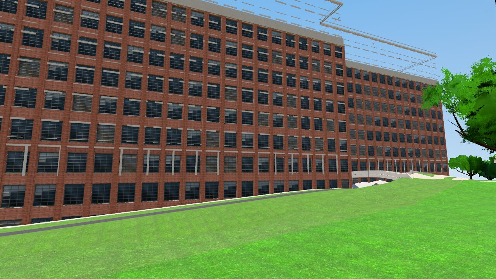
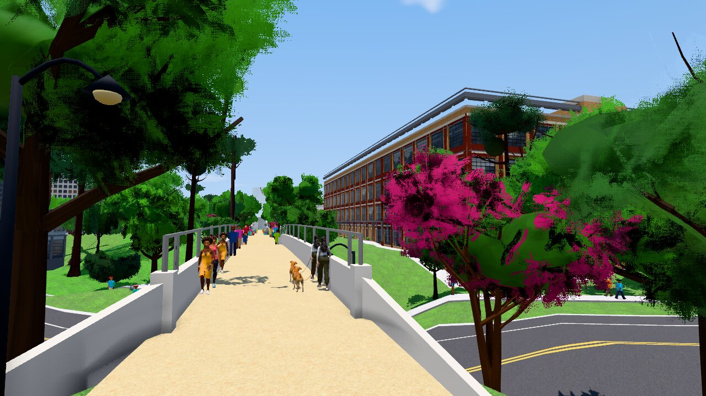
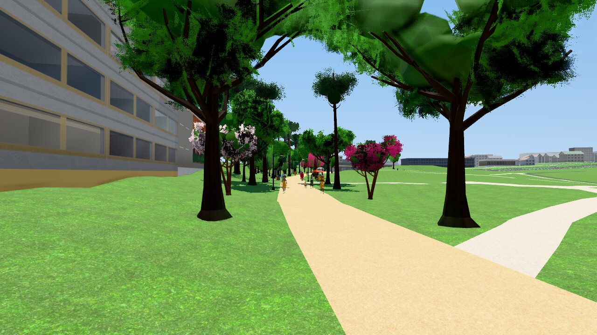
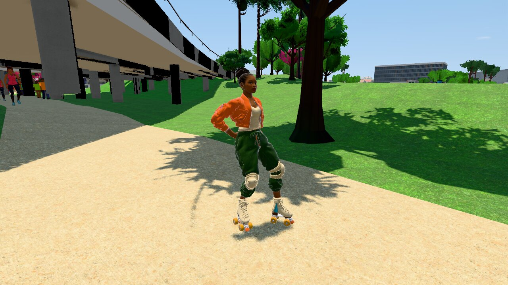
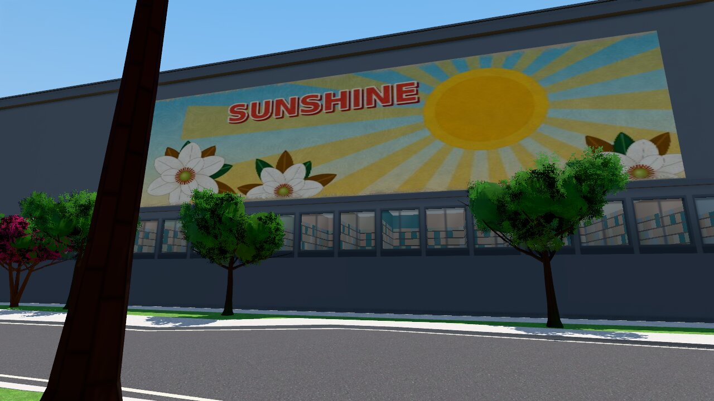
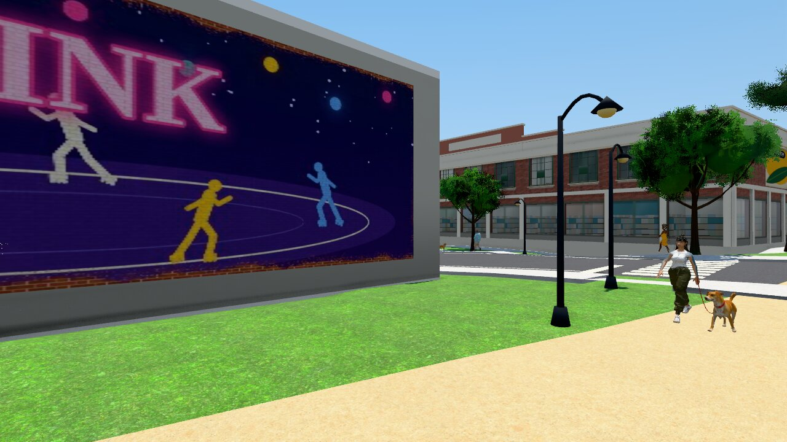
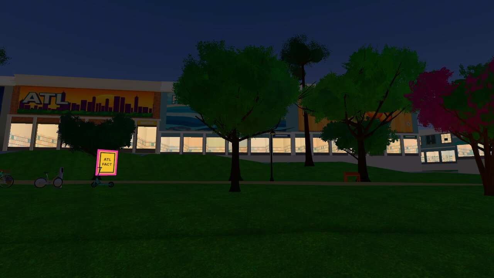
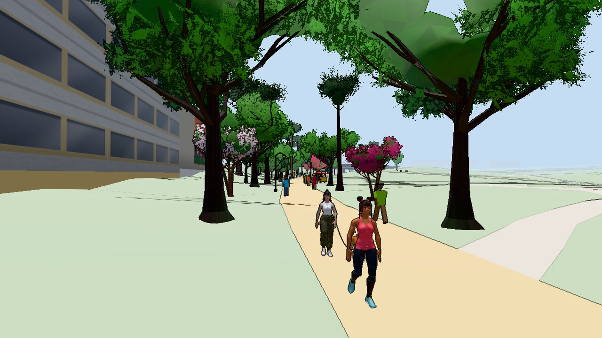
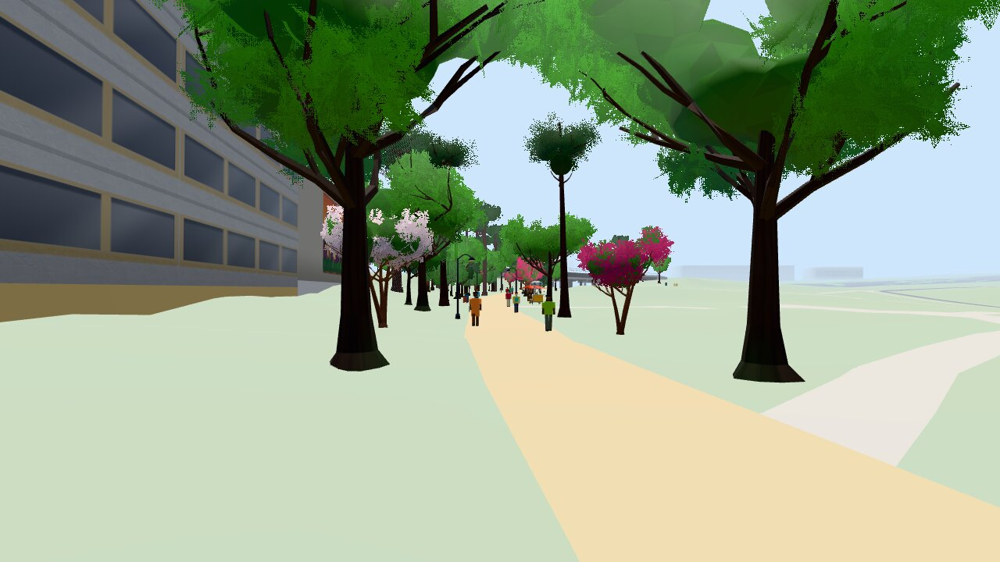

# Art direction: the pbr look (stylized PBR city)

Issue #159. The visual goal for `?look=pbr` on `epic/city-look`.

The toon look keeps its own direction (#111: Jet Set Radio flat cel shades,
thick ink lines, Hi-Fi Rush as a stretch). This doc does not change it. Both
looks share the level, the facade shader, the murals and the props. They
differ in how light falls on them.

The exact values in the code are in `docs/style-sheet-pbr.md` (#157). This
doc says what the look must be; the style sheet says what the code does
today. If the two differ, the code changes to meet this doc, and the style
sheet follows the code.

Read with: `docs/style-sheet-pbr.md`, `docs/murals.md`,
`docs/storefronts.md`, `docs/landmarks.md`, `docs/ground-textures-pbr.md`,
`docs/perf/baseline.md`, and the style frames in `docs/style-frames/` (#114).

## 1. The target

A sunny, warm, lived-in Atlanta you want to skate through: **warm sun,
sky-lit shade and reflections, materials you can read at speed, saturated
but not neon color, and bold original murals and signs.**

Style references, described in words (style only; nothing is copied, no
images are taken from them):

- **Stylized web city demos** (named in #144: teleoperator.mindblown.ai and
  greggman.github.io/gen-city-auto). What we take: a whole city drawn in the
  browser from simple blocks that still feels alive, because the light is
  warm, the shade is blue and soft, the streets have markings and props, and
  the windows vary. Blocks are simple; the light and the small detail do the
  work.
- **Painted, toy-like PBR games** (the "stylized PBR" family: clean shapes,
  real light, hand-tuned color). What we take: physically lit materials with
  a limited palette, big readable shapes, soft sky light in the shade, and a
  light color grade, not a photo look.
- **A summer afternoon on the real Eastside Trail.** What we take: warm
  concrete, deep tree shade, red brick lofts, crepe myrtle pinks, people on
  skates, bikes and on foot, and murals facing the trail.

All art stays original: no copied characters, logos, brands or murals.

## 2. Palette

Rules for every neighborhood:

- **Albedo ceiling:** no wall, ground or prop above 0.6 linear (`#cbcbcb`
  sRGB). Thin trim may go to 0.7 (`#dbdbdb`).
- **Albedo floor:** nothing below 0.03 linear (`#303030`) except glass and
  tire rubber.
- **Saturated, not neon:** paint and murals up to HSV saturation 0.85. Only
  emissive signs at night go above 1.0 in value. No sunlit surface glows.
- **One accent per block** that repeats (an awning, a sign band, a bench, a
  mural background), so a neighborhood reads at speed.
- **Green** is a mid green, never lime and never mint: grass albedo
  `#4f7a3a`–`#6f9a4a`. Crepe myrtle and dogwood pinks are the seasonal
  accent.
- **Asphalt is the darkest ground** in a frame: about 0.09 linear
  (`#545454`), no lilac cast.

Palette per district (sRGB; the code is `DISTRICT_LOOKS` in
`src/render/pbr-palette.js`):

| District (anchor) | Main colors | Accent |
| --- | --- | --- |
| Poncey-Highland (Ponce City Market) | brick `#8c4538` `#9e4d3d`, cream `#c4b08c`, mustard `#c9962e`, teal `#4f9aa6`, coral `#c96f6a`, sage `#8fae86`, peach `#cb8f5e` | mustard `#c9962e`, deep green `#2f5d46` |
| Old Fourth Ward (Iris O4W) | warm gray `#a8a39b`, slate `#525c6b`, orange `#cb7a48`, sky blue `#6f9bbf`, dark trim `#383d47`, stone `#b9b2a6` | orange `#cb6a32`, sky blue `#6f9bbf` |
| Inman Park (Krog Street Market) | sage `#8fa88f`, butter `#cbb478`, lilac `#a890b8`, sky `#8ab3c7`, white trim `#c6c0b0`, pink `#c98fa6`, wood `#b08a68` | lilac `#a890b8`, sage `#8fa88f` |
| BeltLine trail and parks | trail `#b8a27a`, grass `#4f7a3a`–`#6f9a4a`, oxblood `#7a2e2e`, navy `#2e3f66`, mustard `#c9962e` | bench and rail paint: oxblood, navy, mustard |
| Landmarks | historic brick `#7e3a2e` `#8f4434` `#994a3b` (darker than the lofts) | the fictional rooftop signs |

Far windows (bold colors when a window is small on screen): deep blue
`#1c3352`, teal `#1f4f55`, indigo `#2a2f4f`, sky `#3f5f80`, warm pane
`#8a6a3e`.

## 3. Materials per surface

Every surface under `?look=pbr` is a metal/rough standard material. The
roughness carries the read at a distance, not the normal map. Only glass,
wet ground, rails and car paint shine.

| Surface | Albedo | Roughness | Metalness | Rules |
| --- | --- | --- | --- | --- |
| **Brick** | district brick, 0.15–0.35 linear | 0.80–0.92 | 0 | Brick scan with mortar a little rougher than the face. Landmarks use the darker historic brick. Painted brick 0.75. |
| **Concrete** (sidewalk, ledges, bridges, mural panels) | 0.25–0.5 linear, warm gray | 0.75–0.92 | 0 | Concrete scan everywhere, also on bridges and free-standing walls. Worn coping and ledge edges 0.5–0.6 (polished by grinds). Stains only where water runs. Never pure white, never black. |
| **Asphalt** | about 0.09 linear | 0.85–0.95 dry, 0.12–0.3 wet | 0 | The darkest ground. Wet: albedo × 0.35, puddles at 0.12. Markings are paint (0.6–0.7). |
| **Trail** (BeltLine) | `#b8a27a` warm concrete | 0.75–0.9 | 0 | The brightest ground in the frame, but under the ceiling. Seams every few meters; no repeat visible at skating height. |
| **Glass** | dark, interior 5–10× darker than the wall | 0.03–0.28 per pane | 0 | Reflects the sky. Far windows turn into the bold window colors. Storefront interiors vary from shop to shop. |
| **Metal** | painted: the accent colors; bare: steel gray | painted 0.35–0.6, bare 0.25–0.4 | painted 0.6–1.0, bare 1.0 | Rails, poles, benches, lamp posts, bike racks. Grind rails are bare steel. Metal is only for real metal; no paint at metalness 0.5. |
| **Foliage** | grass `#4f7a3a`–`#6f9a4a`, leaves a little darker and cooler | grass and leaves 0.85–1.0 | 0 | Lawns vary in hue and value over tens of meters, with mulch under trees and worn paths. Leaf crowns: lit top, darker inside, soft clean edge, no pixel speckle. Env light × 0.4 on grass so the grazing sky does not haze it. |
| Mural paint | see section 7 | 0.70–0.85 | 0 | Roughness atlas varies with the paint. |
| Sign paint, awnings | accent colors | 0.6–0.9 | 0 | Awnings 0.85–0.9 (canvas). |
| Car paint | any, under the ceiling | 0.2–0.4 | 0 | Clearcoat only if the tier pays. |

No baked light or shadow in any albedo: the sun and the sky light the scene.

## 4. Light and time of day

The day is the weather clock (`src/render/weather-view.js`, `?time=`,
`?date=`, `?weather=`). Each frame has one warm key (sun or lamps) and one
cool fill (the sky). Shadows take the sky color; they are never black and
never gray haze.

| Time | Key light | Fill and reflections | Must read |
| --- | --- | --- | --- |
| Morning (8–10) | Low warm-white sun from the east, long soft shadows | Cool blue sky, strong sky reflections on glass | Fresh and clean |
| Midday (11–16) | High sun, short hard shadows | The sky carries the shade; AO in corners | The default: walls, ground and skaters read at skating height |
| Golden hour (18–20 in summer) | Low orange sun, long shadows down the trail | Warm bounce, blue shade | The hero time for murals and the trail |
| Dusk (20.5–21.5) | Sun gone; sky glow | Deep blue sky, first lit windows, lamps on | Lit windows and signs start to count |
| Night (21.5–5) | Street lamps: warm 4000 K pools, about 60° cone; lit windows; signs | City glow; wet streets reflect everything | Pools of light with dark between them; signs are the hottest thing |

Weather is positive: rain is a wet, shiny, cozy city, never gloom. The rain
sky follows the time of day. Storms are short.

## 5. Fog and grade

**Height fog** (pbr only, `HEIGHT_FOG`): thicker near the ground, thinner
high up (55 % of the distance fog at the top), a light ground haze (up to
0.16) at mid range, and full fog at the far plane at every height so the
far cut never shows. The fog takes 40 % of the district fog tint in the day:

| District | Fog tint |
| --- | --- |
| Poncey-Highland | `#e2cdb4` warm sand |
| Old Fourth Ward | `#c8d6e4` cool blue |
| Inman Park | `#d3dcc2` sage |
| BeltLine trail (default) | `#d6e0e8` pale sky |

Rules: fog adds depth, it does not wash the near city. Within 100 m a wall
keeps at least 85 % of its contrast. Far towers turn toward the fog tint,
not toward gray.

**Grade** (one pass on the linear color before tone mapping, `TIME_GRADES`):

| Time | Contrast (pivot 0.18) | Saturation | Split tone | Black lift |
| --- | --- | --- | --- | --- |
| Day | 1.14 | 1.06 | 0.35 (warm lights, cool shade) | 0 |
| Golden | 1.12 | 1.14 | 1.0 | 0 |
| Dusk | 1.00 | 1.04 | −0.35 (cool) | 0.010 |
| Night | 1.04 | 1.12 | 0.45 | 0.006 |

Each district multiplies a small tint (within 5 % of neutral) and a
saturation of 1.04–1.08. Districts blend over 120 m, so there is no line at
a border. Bloom: threshold 2.4 in the day (nothing sunlit glows), 0.92 at
night.

**Tonal gate:** a day frame spans luma p2 ≤ 20 and p98 ≥ 230 (0–255,
Rec. 709). The middle (p50) sits between 90 and 170.

## 6. Skaters and NPCs

- Skaters keep their glTF standard materials, lit by the sky environment.
  No ink outline under pbr. A soft rim light from the horizon color keeps
  the skater apart from the background (day 0.55, golden 0.8, dusk 0.45,
  night 0.3).
- **Silhouette first.** One saturated main color per outfit (Nia: orange
  jacket) and a contrasting secondary (Nia: navy joggers, #203). Outfits avoid the main colors of the
  places they skate: on the BeltLine that means no grass green and no trail
  sand for big areas.
- Skin roughness 0.45–0.6 (never plastic). Hair 0.5–0.7. Cloth 0.7–0.95,
  satin jackets 0.45–0.55. Faces read at 2 m.
- Skates: cream or colored boots, warm-colored wheels (the brightest accent
  on the character), metal plates and trucks.
- **NPCs** are positive and varied: skaters, joggers, families, dog walkers,
  vendors. Same material ranges as the skaters, smaller textures, one draw
  call each. No police, no crime, no danger.
- Animation: blends, slide and bonk clips, foot IK (#107). Real skaters and
  dancers review the clips.

## 7. Murals

- **Murals, not graffiti.** No tags, no throw-ups, no defaced walls.
- **All original.** Designs come from `scripts/assets/mural-atlas.mjs` or a
  generator with a `provenance.json`. No copies of real murals or real
  artists' styles, no brands, no logos. Words are positive (`MURAL_WORDS`,
  no neighborhood names, #80).
- **Positive subjects:** Atlanta nature (dogwood, magnolia, peach,
  thrasher, the Piedmont), skating and dance, the skyline, neighbors. Every
  neighborhood at its best.
- **Paint on a real wall.** The host wall keeps its own brick or plaster
  material around and under the mural. Free-standing panels have a cap and a
  base. The dry-brush edge shows the wall under the paint.
- **Color:** the most saturated surfaces in a day frame, but under the
  albedo ceiling (paint 0.05–0.6 linear). At night a mural is lit by the
  nearest lamp, not self-lit, unless it carries neon.
- **Placement:** facing the trail and the streets the skater rides, at a
  size that reads at 15 m and at skating speed.
- One atlas and one material for all murals (2048 px high tier).

## 8. What each tier keeps

The pbr look costs about 10 times the toon frame on the phone and low
tiers on the software GPU, after #191 (13 to 15 times before on the same
machine, `docs/perf/191/README.md`). The phone and low tiers default to
toon. The table is the target for each tier with `?look=pbr` on; where
today differs, the cell says so.

| Feature | Low (`?quality=low`) | Phone | High |
| --- | --- | --- | --- |
| Default look | toon | toon | pbr |
| Standard materials and the palette albedos | keep | keep | keep |
| Ground scans (albedo, roughness) | 512 px, no normal (#194), 2x anisotropic (#191) | 512 px, no normal (#194), 2x anisotropic (#191) | 1024 px with normal, 8x anisotropic |
| Wall scans (brick, plaster) | drop | drop | keep |
| Sky environment light | 9 sky SH, no map lookup (#191) | 9 sky SH, no map lookup (#191) | keep, baked again when the sky moves |
| Sun shadow map | drop | drop | keep |
| GTAO | drop | drop | keep |
| Grade (time of day, district) | keep, in the materials (#195) | keep, in one cheap pass (#195) | keep, full pass |
| Toon ink and halftone | drop | drop (#195) | drop |
| Height fog | plain distance fog | plain distance fog | keep |
| Bloom | drop | drop | keep (night signs) |
| Skater rim light | keep | keep | keep |
| Far windows as bold colors | keep | keep | keep |
| Facade kit, interiors, markings, aprons | drop | drop | keep |
| Leaf cards | drop (impostors) | drop (impostors) | keep near trees |
| Murals | painted atlas at 1024 px (today 2048) | painted atlas at 1024 px (today 2048) | 2048 px painted atlas |
| Skater textures | 1024 px | 1024 px | 2048 px |
| NPC textures | 512 px | 512 px | up to 1024 px |
| Draw distance | 320 m | 320 m | 650 m |
| Lamp pools at night | keep (decals) | keep (decals) | keep |
| Comic effects (#113) | drop | keep, reduced | keep |

Budget caps per tier are in `docs/perf/budget.json`; no art change may go
over them.

## 9. Check against the target (2026-11-06)

Real game renderer, Playwright headless (Chromium + SwiftShader),
1280×720, `?level=beltline-eastside&look=pbr&quality=high&date=06-21&time=13.5&weather=clear&npcs=0&cars=0&view=fixed`,
commit `de429e3` (the tip of `epic/city-look` with PR #182). Cameras:
`scripts/art/shots-159.json`. Rebuild:

```bash
node scripts/art/pbr-frames.mjs --shots scripts/art/shots-159.json --out <dir>
```

Frames are in `docs/art-direction-pbr/` with `provenance.json` and the
capture log (`shots-log.json`). Contact sheet: `docs/art-direction-pbr/contact-sheet.jpg`.

| Frame | Luma p2 / p50 / p98 | Draw calls | Triangles |
| --- | --- | --- | --- |
| Ponce City Market | 24 / 91 / 191 | 192 | 389k |
| Telephone Factory trail bridge | 0 / 100 / 229 | 333 | 1.23M |
| Trail by the spawn | 1 / 151 / 236 | 303 | 847k |
| Skater close-up | 0 / 166 / 230 | 448 | 1.44M |
| Mural wall | 4 / 86 / 184 | 218 | 1.04M |
| Krog Street Market | 4 / 125 / 230 | 234 | 513k |
| Night, Inman Park storefronts, 22:30 | 7 / 27 / 185 | 300 | 976k |
| Trail, phone tier | 4 / 215 / 231 | 88 | 241k |
| Trail, low tier | 6 / 215 / 231 | 82 | 168k |
| Trail, phone tier, after #195 (2026-11-07) | 3 / 149 / 236 | 87 | 240k |
| Trail, low tier, after #195 (2026-11-07) | 4 / 151 / 236 | 82 | 168k |

All high-tier frames are under the 555 draw call cap.

### Ponce City Market from the trail



- **Meets:** the historic brick reads dark and rich; the windows are dark
  glass with sky reflections and varied panes; the lawn is green, not mint.
- **Misses:** broken white dashed lines float above the roof (#200). The
  sky is one flat blue, so the frame misses the tonal gate (p98 191, #201).
  The sunlit lawn is lime and flat (#197).

### Trail bridge by the Telephone Factory Lofts



- **Meets:** the best frame: warm trail, crepe myrtle pink, a brick loft
  with warm trim, people and dogs on the trail, dark asphalt with yellow
  lines, deep shade under the trees. Meets the tonal gate.
- **Misses:** the bridge parapets are near pure white (#199). Leaf crowns
  have dark speckled edges (#202).

### BeltLine trail by the spawn



- **Meets:** warm trail, the pinks, tree shadows, a soft haze on the far
  buildings, the tonal gate (p2 1, p98 236).
- **Misses:** the lawn is one flat lime green over the whole frame (#197).
  Leaf-card speckle on the near crowns (#202).

### Skater close-up (Nia)



- **Meets:** Nia reads at once: the orange jacket, cream boots, warm
  wheels, a crisp shadow on the trail. Skin is not plastic. Tree shadows on
  the lawn have soft, leafy edges.
- **Misses:** her dark green pants sit on the green lawn (#203). The bridge
  underside is flat beige and the piers are near black (#199).

### Mural wall



- **Meets:** the SUNSHINE mural is bold, original and positive, and it is the
  most saturated thing in the frame. Asphalt is dark gray with no lilac
  cast. The sidewalk reads lighter than the road.
- **Misses:** the wall around the mural is a flat dark slate with no brick
  or plaster (#198). The sky fills the top with no gradient (p98 184, #201).
  Every storefront window shows the same shelf interior.

### Krog Street Market (Inman Park)



- **Meets:** the RINK mural reads at a distance; the brick storefront row,
  lamp posts, crosswalk and people give a lived-in street.
- **Misses:** the mural panel is flat smooth gray with no cap or base (#198).
  The lawn is lime and flat (#197).

### Night, Inman Park storefronts, 22:30



- **Meets:** deep navy sky (not blue-gray any more), warm lit shop
  windows, the murals above the shops still read.
- **Misses:** no lamp pools: the lawn and paths are one dark green
  (p50 27). The yellow fact card is the brightest thing, not a sign (#196).

### Trail on the phone and low tiers (`?look=pbr`)

| Phone | Low |
| --- | --- |
|  |  |

- **Meets:** same layout and colors of the trail, trees and people; 82–88
  draw calls.
- **Misses (2026-11-06):** the lawn is pale mint and the ground flat (no
  scans; #194 adds them); no shadows; the frame is washed out (p50 215). On
  the phone tier the lite post pass draws the toon ink and has no grade
  (#195).
- **After #195 (2026-11-07):** the frames above are new. The phone tier
  draws no ink and no halftone. Both tiers apply the pbr grade, the split
  tone and the district tint: the phone tier in one cheap pass, the low
  tier in the materials. Luma p50 149 (phone) and 151 (low); the lawn mean
  is `#75ab4a` on both. Before and after at the same camera:
  `art-direction-pbr/trail-195-before-after.jpg` (before: the tip of
  `epic/city-look`, 88e6eec, p50 143 and 146). The toon look does not
  change: `art-direction-pbr/trail-195-toon-check.jpg`.
- **Still misses:** no shadows (by the tier table). The lawn is still
  brighter than the `#4f7a3a`–`#6f9a4a` range in full sun (#197).

### Summary

| Area | Meets the target | Gap |
| --- | --- | --- |
| Palette and albedo limits | Mostly: walls, asphalt, brick, trail | Bridges outside the limits (#199); lawn lime in sun (#197) |
| Brick | Yes | — |
| Concrete | Sidewalks and trail yes | Bridges, mural panels (#198, #199) |
| Asphalt | Yes (dark, no lilac) | — |
| Trail | Yes | — |
| Glass | Yes (day) | Repeated storefront interiors (minor) |
| Metal | Lamp posts and rails read | — |
| Foliage | Shade and pinks yes | Lawn variation (#197), leaf speckle (#202) |
| Light, day | Yes: hard sun, blue shade | — |
| Light, night | Sky and windows yes | Lamp pools, hot signs (#196) |
| Fog and grade | Grade yes; fog gives depth | Sky gradient for the tonal gate (#201) |
| Skater | Yes, reads clearly | Outfit vs lawn (#203) |
| NPCs | Varied and positive | — |
| Murals | Strongest asset | Host walls (#198) |
| Phone and low tiers | Layout and color; no ink, grade on (#195) | Ground (#194), lawn (#197) |
| Bugs | — | Lines over Ponce City Market (#200) |

## 10. Gaps (each is a GitHub issue linked to #159)

1. **#195** Phone tier: drop the toon ink, keep the grade and the palette.
2. **#196** Night: lamp pools on the ground and hot sign cores.
3. **#197** Lawn: break up the flat lime green in full sun.
4. **#198** Murals: give mural walls and panels a real wall material.
5. **#199** Bridges and underpasses: concrete inside the albedo limits.
6. **#200** Ponce City Market: broken white lines float above the roof.
7. **#201** Sky: gradient and fair-weather clouds so sky-heavy frames reach
   the tonal gate.
8. **#202** Trees: leaf-card edges alias into dark speckle.
9. **#203** Skater: Nia's green pants merge with the BeltLine lawn.

Open work that already covers part of the target: #157 (materials and
palette, FPS gate on a real GPU), #158 / #194 (ground sets, also on phone
and low), #191 (pbr shading cost), #113 (comic effects), #118 (the beat).

## 11. Effects (#113)

Comic effects ride on the pbr look as a layer, not a new look:

- Speed lines at high speed: thin warm-white streaks at the frame edge,
  never over the skater.
- Impact frame on a bonk or a hard landing: 2–3 frames of a radial burst in
  the district accent, not a full-screen flash.
- Bursts on a grind start and on beat moves (#118): small star or ring
  decals in the accent, bloom only on the hot core.
- Off on the low tier and with `prefers-reduced-motion`.
- Effects are emissive overlays; they never change materials or the grade.

## 12. What stays out (AGENTS.md political rules)

- Every neighborhood at its best: no decline, no stigma, no boarded
  windows, no trash, no ruins.
- No crime, police or traffic danger as content. Obstacles are cones,
  crowds and construction.
- Murals, not graffiti; no tags. All murals and signs are original. No real
  brands or logos. Shop and landmark signs are fictional or plain.
- Facts are positive or neutral, from the open data catalog.
- Real skaters review the move set before release.

## 13. History: the first check and the style frames (#114)

The first version of this doc (2026-11-05, before PR #182) found a pale
mint lawn, a compressed tonal range, blue-gray dusk and night, lilac
asphalt, and a skater with no edge. PR #182 (#157, #160) fixed those: the
check above shows a green lawn, the tonal gate met on the trail frames, a
navy night sky, dark asphalt and a skater rim. Those "today" frames are
still in `docs/style-frames/today/` (cameras in `scripts/art/shots-today.json`).
Note: the "street" camera there (-80, 640) is in the Inman Park district
(within 380 m of Krog Street Market), not Old Fourth Ward.

The style frames (#114) in `docs/style-frames/<subject>/` show one clear
direction per option (A today, B hot noon, C golden hour, D overcast, E wet
or neon night), made from in-game captures and scripted ImageMagick
paintovers (`scripts/art/paintover.sh`), no image model. Rebuild:
`node scripts/art/pbr-frames.mjs` then
`node scripts/art/style-frames.mjs --raw <frames dir>`. The owner picks the
frames to keep; the picks replace the option lists.

## Follow-ups that use this doc

- **#157** materials and palette, **#158** ground sets, **#160** look pass
  (closed by PR #182): the rules in sections 2–5.
- **PBR #106** (textures and murals per neighborhood) and **PBR #107**
  (animation): sections 3, 6 and 7. The toon #106 and #107 keep #111.
- **#113** comic effects and **#118** the beat, layered on top.
- The gap issues in section 10.
