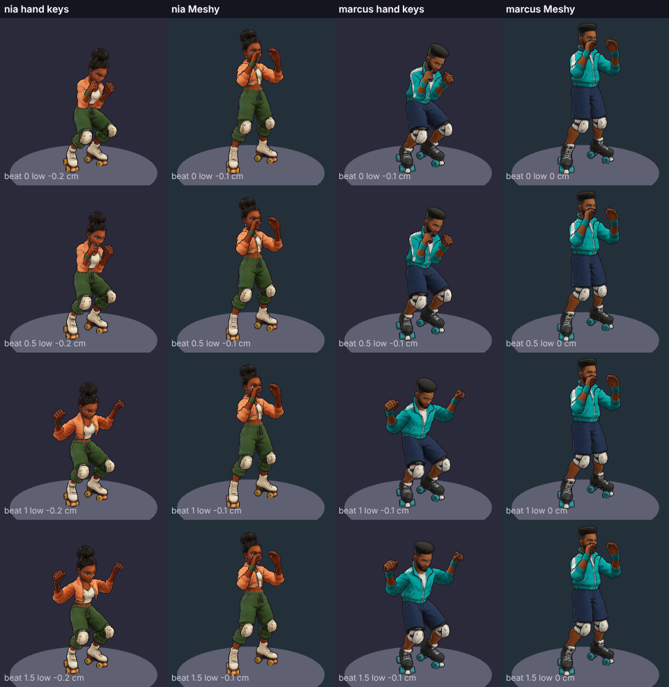
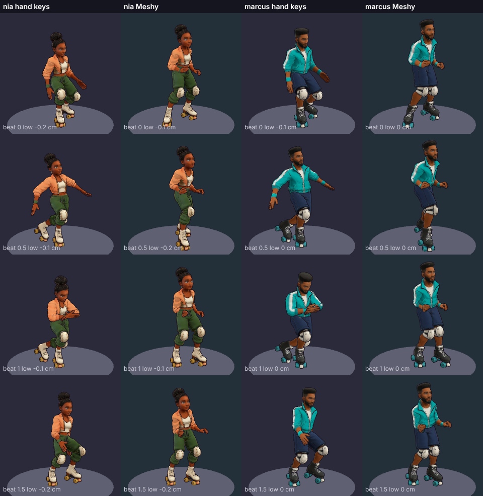
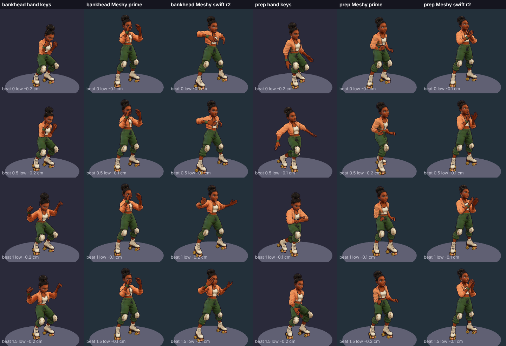
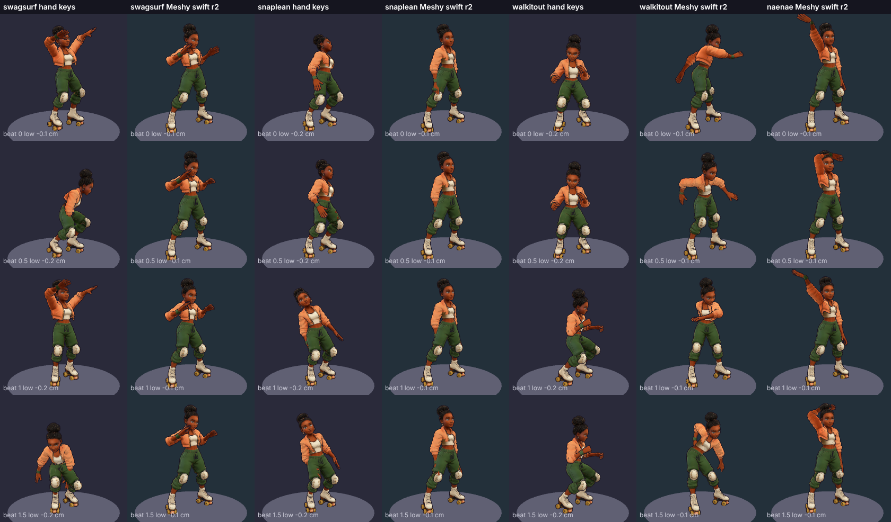
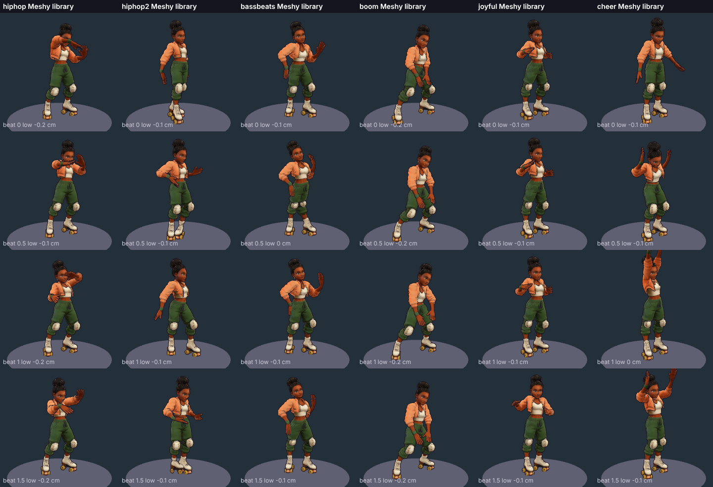

# Meshy text-to-motion test: Bankhead Bounce and The Prep (#293)

Date: 2026-11-15. Result: **keep the hand keys. Wait for the motion capture (#116).** See `docs/decisions.md`, 2026-11-15.

## What we did

1. We wrote 2 text prompts from `docs/characters/atl-dance-references.md` (section 4, Bankhead Bounce; section 2, The Prep). The Meshy API accepts a maximum of 400 characters, so the prompts are short. The full prompts are in `assets/dances/meshy-293/*/provenance.json`.
2. We generated each motion with Meshy text-to-motion, mode `prime`, 4 s. Cost: 10 credits for each clip, 20 credits in total. The owner approved the cost before the calls.
3. `scripts/blender/meshy_retarget.py` (headless Blender 5.2.4) retargeted each motion onto the Mixamo rig of Nia and Marcus, cut the best loop of 2 beats, retimed it to the game clip length (48 frames at 30 fps), and held the wheels on the ground with the leg IK.
4. `scripts/dance-compare-sheet.mjs` rendered the hand-keyed clips (after #292) and the Meshy clips side by side in headless Chromium (`dance-compare.html`, a dev page). The clips play at the game tempo (100 BPM), with no procedural layers (#291).

## Evidence

| Dance | Contact sheet, front | Contact sheet, side | Video (3 loops) |
|---|---|---|---|
| Bankhead Bounce | `contact-bankhead-front.png` | `contact-bankhead-side.png` | `bankhead.mp4`, `bankhead.gif` |
| The Prep | `contact-prep-front.png` | `contact-prep-side.png` | `prep.mp4`, `prep.gif` |

Columns: Nia hand keys, Nia Meshy, Marcus hand keys, Marcus Meshy. Rows: beats 0, 0.5, 1, and 1.5. Each cell gives the lowest point of the skinned mesh ("low") in cm. `probe.json` has all the measurements.





## Measurements (`probe.json`, Nia; Marcus is almost the same)

Largest bone rotation away from the pose at beat 0, over 1 loop (degrees):

| Bone | Bankhead, hand | Bankhead, Meshy | Prep, hand | Prep, Meshy |
|---|---|---|---|---|
| LeftShoulder | 51.4 | 1.7 | 14.5 | 23.8 |
| LeftArm | 125.7 | 3.1 | 76.5 | 51.1 |
| LeftForeArm | 96.8 | 2.4 | 100.4 | 54.6 |
| Head | 50.5 | 1.8 | 20.6 | 9.0 |
| Hips | 9.8 | 1.4 | 11.8 | 23.9 |

| Measurement | Bankhead, hand | Bankhead, Meshy | Prep, hand | Prep, Meshy |
|---|---|---|---|---|
| Distance between the wrists (cm) | 24 to 84 | 37 to 38 | 7 to 91 | 14 to 38 |
| Hip height (cm) | 74 to 83 | 93 to 95 | 73 to 80 | 89 to 94 |
| Lowest skate point (cm) | -0.2 | -0.1 | -0.2 to -0.1 | -0.2 to -0.1 |

## Findings

**Bankhead Bounce: fail.** Meshy made a static "fists up" pose with a small sway. In the raw 4 s motion, the wrists move less than 3 cm and the shoulders move less than 1 cm. There is no shoulder bounce, no cross of the forearms, and no open. No retarget or cut can add a move that is not in the source.

**The Prep: partial, but not The Prep.** Meshy made a forward walk with a small cross step, and the hands meet about once each second. But:
- The **right** foot crosses **in front**. The source (USA Roller Sports) says that the **left** leg crosses **behind**.
- The hands meet at the waist, not in a clap at the chest. The smallest wrist gap is 14 cm.
- The motion has no clean 2-beat loop. The best loop is 58 frames (62 BPM for 2 beats), and its seam error is 6 times the seam error of the Bankhead. The retime makes it 21 % faster.

**What Meshy does better.** The weight shift and the hip sway look more natural than the hand keys. The body is never in a fixed pose.

**What the pipeline proves.** The retarget works: SMPL-H to Mixamo, the loop cut, the retime, and the leg IK keep the wheels on the ground (lowest point -0.2 cm to 0 cm on all 4 clips). A Meshy clip costs 10 credits, and each task was done in less than 20 s. The script can retarget any SMPL-H motion, for example a motion-capture clip from #116, if it uses the same skeleton.

**What the clips do not have.** Meshy stands upright (hips at 93 cm to 97 cm). The hand keys use a skate crouch (hips at 73 cm to 86 cm). A Meshy dance needs a crouch layer before it looks like skating.

## Limits of this test

- 1 prompt and 1 generation for each dance. A second round of prompts can give a different result. We did not spend more credits without a new approval.
- The test compares the raw clips. In the game, the procedural layers of #291 move both sources.
- Real skaters and dancers did not review these clips (AGENTS.md rule).


## Round 2: move-level prompts and the Meshy animation library (2026-11-15)

The owner approved a second round. Cost: 18 credits for 6 swift prompts, 5 credits for 1 rig, and 18 credits for 6 library animations (41 credits). The total for #293 is 61 credits.

### What we changed in the prompts

The first prompts named the dance and gave a BPM. The round 2 prompts give no dance name and no BPM. Each prompt tells 1 or 2 large body actions with strong verbs, keeps the dancer in place, and ends with "Repeat 4 times with big, clear moves". The prompts are in `assets/dances/meshy-293-r2/*/provenance.json`. Meshy swift gives a BVH file with other joint names; the retarget script now reads BVH too.

### The Meshy animation library

The Meshy API lists 678 preset animations (`GET /openapi/v1/animations/library`), with 33 in the "Dancing" category. A library animation needs a character that Meshy rigged. We rigged the Nia mesh (no textures, T-pose) and applied 6 dances that keep the feet on the ground: Hip Hop Dance (#591), Hip Hop Dance 2 (#593), Bass Beats (#65), Boom Dance (#66), Joyful Dance with Hand Sway (#405), and Cheer with Both Hands Up (#298). We did not use dances named after songs ("Gangnam Groove", "Shake It Off Dance", "YMCA Dance").

### Evidence

| Sheet | Contact sheet | Video |
|---|---|---|
| Bankhead and Prep: hand keys, prime (round 1), swift (round 2) | `contact-r2-bankhead-prep-front.png` | `r2-bankhead-prep.mp4`, `.gif` |
| Swag Surf, Snap Lean, Walk It Out (hand keys and swift), Nae Nae (swift) | `contact-r2-more-front.png` | `r2-more.mp4`, `.gif` |
| 6 library dances | `contact-lib-front.png` | `lib.mp4`, `.gif` |







### Measurements (Nia, 1 loop)

Arm and forearm: the largest rotation of the upper arm and the forearm away from beat 0 (degrees). Wrist gap: the range of the distance between the wrists (cm).

| Clip | Arm | Forearm | Hips | Wrist gap | Result |
|---|---|---|---|---|---|
| Bankhead, hand keys | 126 | 97 | 10 | 24 to 84 | reference |
| Bankhead, prime (round 1) | 3 | 2 | 1 | 37 to 38 | fail: static |
| Bankhead, swift (round 2) | 60 | 93 | 5 | 49 to 102 | **better**: the forearms cross and open. A small shrug. |
| Prep, hand keys | 81 | 119 | 12 | 7 to 91 | reference |
| Prep, prime (round 1) | 51 | 55 | 24 | 14 to 38 | fail: a walk |
| Prep, swift (round 2) | 36 | 45 | 1 | 4 to 27 | **partial**: a real clap at the chest. No foot cross. |
| Swag Surf, swift | 45 | 46 | 36 | 51 to 56 | partial: a hip sway. The arms do not take the shoulder pose. |
| Snap Lean, swift | 8 | 9 | 4 | 38 to 40 | fail: static |
| Walk It Out, swift | 178 | 180 | 86 | 49 to 81 | fail: the body turns a full circle. The loop seam is bad (0.86 m). |
| Nae Nae, swift (no hand-keyed clip) | 53 | 99 | 6 | 82 to 104 | **good**: the right arm is up and waves. |
| Library Hip Hop Dance (#591) | 137 | 124 | 21 | 32 to 62 | lively, not Atlanta |
| Library Hip Hop Dance 2 (#593) | 79 | 108 | 25 | 30 to 64 | lively, not Atlanta |
| Library Bass Beats (#65) | 54 | 58 | 12 | 57 to 62 | medium |
| Library Boom Dance (#66) | 27 | 26 | 38 | 28 to 34 | hip move, small arms |
| Library Joyful Dance (#405) | 49 | 50 | 19 | 48 to 60 | medium |
| Library Cheer (#298) | 149 | 161 | 14 | 33 to 75 | a one-shot cheer, not a loop (seam 0.55 m) |

All 12 new clips keep the lowest skate point between -0.2 cm and 0 cm. The hips go down by up to 8 cm in some frames, because the Meshy motion stands taller than the skater can reach the ground. All Meshy clips stand upright (hips at 82 cm to 98 cm); the hand keys use a skate crouch (70 cm to 92 cm).

### Findings, round 2

- Prompts that tell body actions work much better than prompts that name a dance. The Bankhead forearms now move 93 degrees (round 1: 2 degrees), and the Prep has a real clap.
- Meshy does not do the foot work: no crossed foot in the Prep, and a full turn in Walk It Out. Upper-body moves come out best (Bankhead arms, Nae Nae arm).
- Swift is good enough to test prompts at 3 credits. Prime costs 10 credits and gave less motion in round 1, but round 1 also had the weaker prompts, so this test does not compare the 2 modes fairly.
- The library dances are smooth and lively, but they are generic studio dances, not Atlanta dances. They can fit NPC skaters or crowd grooves. Check the Meshy license terms for library animations before any release use.

## Rerun

```bash
blender -b --factory-startup -P scripts/blender/meshy_retarget.py -- --skater assets/skaters/nia/skater.glb --name nia --motion assets/dances/meshy-293/bankhead/source-smplh.glb --clip dance_bankhead_meshy --out assets/dances/meshy-293/bankhead/nia.glb
```

```bash
npx vite --port 5193 &
node scripts/dance-compare-sheet.mjs
```
