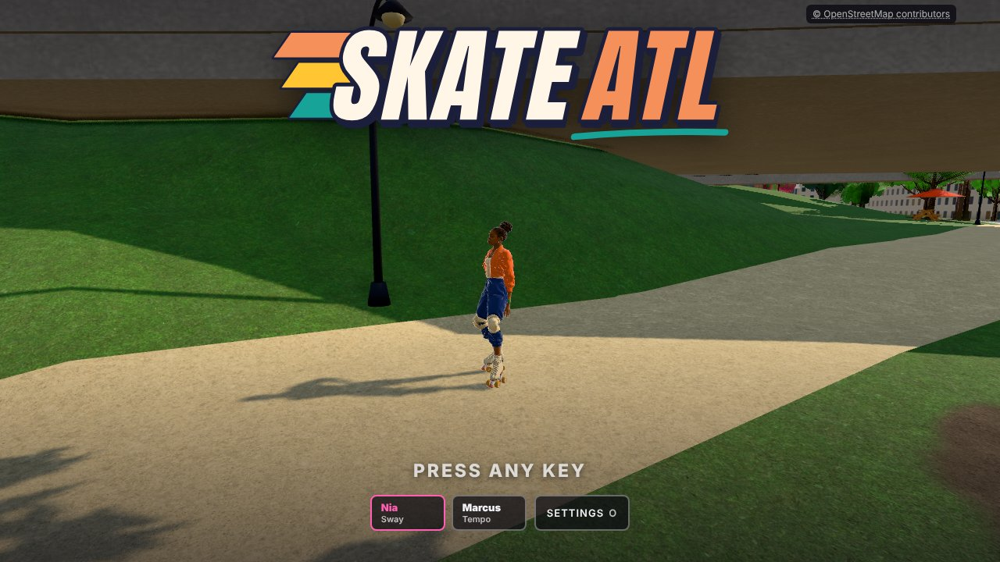

# Skate ATL: a free game that shows Atlanta at its best

**For:** the Mayor's Office of Technology and Innovation (OTI). **Date:** 2026-11-24. **Status:** draft for the owner. Nobody was contacted.
**Play it now:** https://skate-atl.vercel.app (a laptop or a phone browser, no install, no account).

## What the game is

Skate ATL is a free roller skate game in the browser. The player skates the real BeltLine Eastside Trail, from Ponce City Market to Krog Street Market: about 1.9 km of real streets, buildings and parks, built from OpenStreetMap and City of Atlanta data. The movement is fast and smooth: push, grind rails and ledges, jump, and dance on the roll with Atlanta moves such as Walk It Out and Swag Surf. A fall never ends the run. The game plays with a keyboard, a gamepad or touch.

## What it teaches

- **13 real landmarks.** When the skater rolls near a landmark, the game finds it and shows one short line. Each spot has a skate challenge. When the player lands it, the spot is claimed, and the full map shows its story card.
- **65 facts, each with a source.** Examples: Ponce City Market opened in 1926 as a Sears, Roebuck and Co. store and warehouse (National Register of Historic Places). Thomas Taylor Memorial Skatepark is Atlanta's first public skatepark, open since spring 2011 (Atlanta BeltLine, Inc.; Historic Fourth Ward Park Conservancy).
- **City open data in play.** Fact cards come from City of Atlanta Department of City Planning GIS data: the trail links Inman Park, Old Fourth Ward and Poncey-Highland; Freedom Park covers 124 acres of city park land; Inman Park-Reynoldstown MARTA station is within a mile of the trail.
- **Tour mode** has no timer. A visitor or a student rides the whole trail at their own speed, and the game names the next landmark and its direction.
- **Planned for schools:** a teacher mode with no student accounts and no personal data, mapped to grade 8 Georgia Studies (for example SS8H12, SS8E1, SS8G1).

## Data sources

| Source | Used for |
|---|---|
| OpenStreetMap (ODbL 1.0) | Building footprints, streets, sidewalks, curbs, trees |
| Overture Maps Foundation, USGS 3DEP | Building heights, ground elevation |
| City of Atlanta Department of City Planning GIS, through the open-data-atl catalog | Street names, building addresses, and the fact cards (neighborhoods, parks, MARTA stations) |
| National Register of Historic Places (National Park Service) | Landmark history |
| Atlanta BeltLine, Inc., Historic Fourth Ward Park Conservancy, Freedom Park Conservancy, Jimmy Carter Presidential Library and Museum | Landmark facts |

Each fact in the game names its source. The full list is in `docs/pitch/2026-11-01-official-game-of-atlanta.md`, section 4.

## The rules the game keeps

1. Every neighborhood is shown at its best. No decline, no stigma.
2. No crime, police or traffic danger. Cars move calmly, and they slow and stop for the skater.
3. Murals, not graffiti. The murals in the game are original designs.
4. Facts are positive or neutral, and each fact has a source.
5. Real skaters review the move set before Version 1.

An agent checked the current game against these rules (24 checks: 20 pass, 3 flagged with fixes in progress, 1 open for Version 1). Code filters block crime, crash and decline data and words. The game has no chat, no accounts, no ads and no user content.

## Why Atlanta, why now

- We found no other US city with an official video game.
- Roller skating is a living Atlanta tradition across generations.
- OTI already teaches game design in its youth esports labs. Lab students can playtest the game and see how a city game is made.
- The game is free and on the open web. The City can link to it from any page.

## The ask

1. **A playtest in the OTI youth esports labs**, with feedback from the students.
2. **A partner agreement with OTI** as the lead City sponsor of Skate ATL.
3. **After the agreement:** support for a City Council resolution that names Skate ATL the official game of the City of Atlanta.

The game does not use the City seal, the City logo or the words "official game" before a written agreement.
