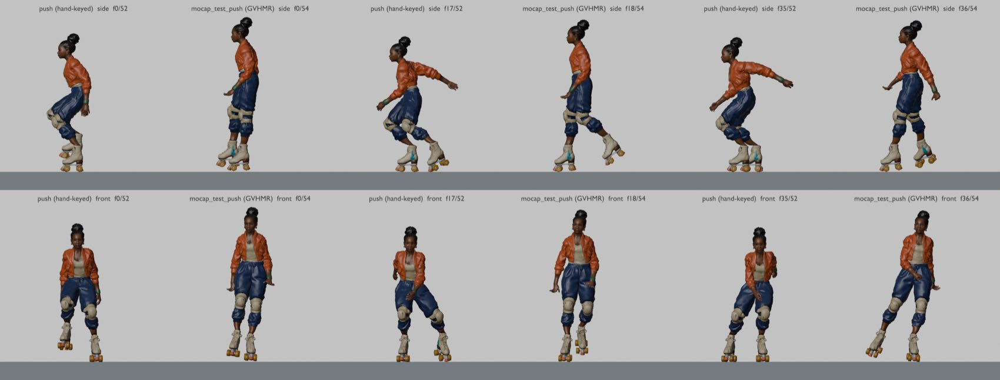
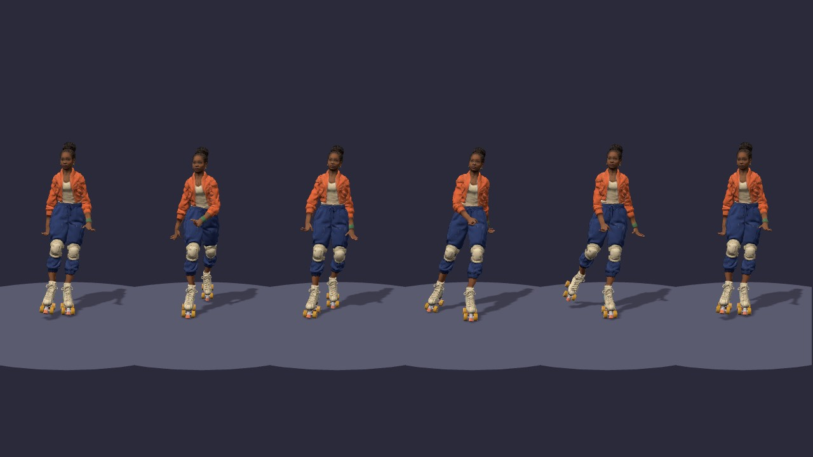

# GVHMR video mocap test: run on a Modal T4, mocap clip is worse than the hand-keyed clip

Date: 2026-11-21 (setup), 2026-11-22 (run). Branch: `claude/wizardly-mayer-binhnd` from `main`.

## Result

- **The test ran from start to end on Modal, on an NVIDIA Tesla T4 (15,360 MiB).** The runner is `scripts/mocap/gvhmr_modal.py`. The clip is `assets/skaters/nia/mocap-test/mocap_test_push.glb` (54 frames, 1.8 s, 2,152,960 bytes).
- **Verdict: the mocap clip is worse than the hand-keyed `push` clip. Do not use it.** The jitter is 2 times higher (15.4 against 7.59 m/s²). The pose is upright, with almost no knee bend and no forward lean, so it does not look like a skate push. The source root speed is only 0.25 m/s, so the clip has almost no push power. Only the loop seam is better (0.44 against 1.26 m/s).
- No shipped clip changed. The clip table in `scripts/blender/nia_clips.py` did not change. The game does not load the mocap clip.
- **The pipeline cannot be used for a shipped clip.** GVHMR and SMPL-X are for non-commercial research only. See "Licenses".

## Run on Modal (2026-11-22)

| Item | Value |
|---|---|
| Runner | Modal, `modal==1.6.4` client, GPU `T4` (Tesla T4, 15,360 MiB, driver 610.57.04) |
| Image | Debian slim, Python 3.11; Blender 5.1.2; GVHMR venv Python 3.10, torch 2.3.0+cu121, pytorch3d 0.7.6 |
| Checkpoints | On the volume `skate-atl-mocap`; sizes and sha256 in `provenance.json` |
| SMPL-X | v1.1 `SMPLX_NEUTRAL.npz`, downloaded by the owner after registration; sha256 `376021446ddc86e99acacd795182bbef903e61d33b76b9d8b359c2b0865bd992`; on the volume only |
| Video | [Pexels 8402599, "A Woman Using Her Roller Skates"](https://www.pexels.com/video/a-woman-using-her-roller-skates-8402599/), file `8402599-hd_1920_1080_25fps.mp4` |
| Creator | SHVETS production (`pexels.com/@shvets-production`) |
| License | Pexels License (`https://www.pexels.com/license/`) |
| Trim | 0 to 15 s, resampled to 30 fps (450 frames) |

The video shows one skater on quad skates, full body, from the front. The camera moves backward with her. The 6 Wikimedia Commons candidates that were previewed were not usable: the skater was too small, the camera panned, or there were many people in the frame.

### Fixes to the runner

The first GPU run stopped at step 11. These changes are in `scripts/mocap/gvhmr_modal.py`:

1. MediaPipe (the feet and hands step) needs `libGLESv2.so.2`. The image now installs `libgles2`. Without it, the GVHMR result had no foot refinement. With it, the fit to the 2D keypoints went from 4.1 cm to 1.5 cm (heel and toe 4.2 cm to 1.6 cm).
2. `nia_mocap_clip.py` runs `prune_static_channels()` from `scripts/blender/nia_clips.py`. The image now copies that file (read only).
3. `::setup` downloads the checkpoints before it checks for SMPL-X, so the first setup does useful work before the license step.

### Metrics

`assets/skaters/nia/mocap-test/metrics.json`. The skid is measured at 3 m/s, because the source root speed (0.25 m/s) is below the 0.3 m/s limit of the script.

| Clip | Frames | Penetration | Hover frames (> 1 cm) | Jitter (m/s²) | Skid mean / p95 (m/s) | Loop seam (m/s) |
|---|---|---|---|---|---|---|
| `push` (hand-keyed, shipped) | 52 | −0.01 cm | 0 | 7.59 | 0.519 / 1.131 | 1.262 |
| `mocap_test_push` (GVHMR) | 54 | 0.00 cm | 0 | **15.4** | 0.518 / 0.995 | **0.437** |

Clip report (`assets/skaters/nia/mocap-test/clip_report.json`):

- Loop window: motion frames 393 to 447, loop cost 0.0029, blend 6 frames.
- Source travel 0.454 m over the window (0.252 m/s). Heading drift removed: −2.09°/s.
- Before the wheel lock, the lowest skate was 3.5 to 11.8 cm above the ground. After it, 0.00 to 0.77 cm. The leg IK lifted 26 skate frames, lowered 55, and clamped 12 at full reach. The largest change was 1.78 cm.
- The retarget found 0 footfalls, as expected with all contacts off. The camera root correction was 2.13 m at most.

### Comparison sheet

Side and front views at the start, at one third, and at two thirds of each clip. Hand-keyed `push` is on the left of each pair.

### What the sheet and the metrics show

- **Pose.** `push` has a low skate crouch: bent knees, a forward lean, and the arms out for balance. The mocap clip stands almost straight, with the arms low. The skater in the video does stand upright and dances in part of the clip, so this is partly the video and partly GVHMR.
- **Jitter.** The mocap clip has 2 times the jitter of `push`. The loop window and the wheel lock do not remove it.
- **Push power.** The root moves 0.25 m/s. A push in the game is approximately 3 m/s. A moving camera that follows a skater at her speed gives GVHMR almost no travel to see.
- **Ground contact.** The wheel lock works: no wheel goes under the ground, and no frame hovers more than 1 cm. But 12 skate frames needed a leg at full reach, so some poses changed to touch the ground.
- **Better points.** The loop seam is smoother than in `push` (0.44 against 1.26 m/s). The skid is similar.

### Evidence in the game viewer

`e2e/mocap-test.spec.js` opens `skater.html?skater=nia&clips=/assets/skaters/nia/mocap-test/mocap_test_push.glb` in headless Chromium (Playwright). The new `?clips=` option of the skater viewer adds the clips of a second GLB to Nia. The test checks that the clip loads with no page error, that it has more than 10 tracks and more than 1.5 s, and that two sheets of it differ. Result: passed (with `e2e/skater-model.spec.js`, 3 of 3 passed).

### Recommendation

Keep the hand-keyed clips. Do not do more work on GVHMR for Skate ATL: the license stops a shipped clip, and the quality is lower than the hand-keyed clip. If video mocap is necessary later, use a static camera with a side view of a skater who moves across the frame, and a solver with a commercial license.

## How to run (owner)

1. Register at `smpl-x.is.tue.mpg.de`, accept the license, download SMPL-X v1.1 (NPZ+PKL), and put `SMPLX_NEUTRAL.npz` in Google Drive at `MyDrive/skate-atl-mocap/`. An agent cannot accept this license for the team.
2. Open `scripts/mocap/gvhmr_colab.ipynb` in Colab. Set a GPU runtime (T4 is sufficient).
3. In cell 1, set the video: a Wikimedia Commons file (`COMMONS_FILE`) or a Pexels video (`PEXELS_*`), and `T0`, `T1`. Cell 7 lists Commons candidates with their license, creator, size, and length. Use one skater, full body, steady camera, side or front view, 5 to 15 s.
4. Run all. The outputs go to `MyDrive/skate-atl-mocap/out/<time>/`.

Cell 8 stops if the license is not CC0, public domain, CC BY, CC BY-SA, or the Pexels license.

### Other runner: Modal (no browser)

`scripts/mocap/gvhmr_modal.py` does the same 14 steps on a Modal GPU (T4 by default; set `MOCAP_GPU=L4` for an L4). It uses the same pins, the same retarget values, and the same Blender scripts. An agent can run it from start to end with `modal run`, because it does not need a browser tab. Run it from a computer that can reach Modal: the Modal client uses gRPC, and the cloud session proxy does not allow gRPC.

1. One time: `pip install "modal==1.6.4"`, `modal token new`, `modal volume create skate-atl-mocap`, and `modal volume put skate-atl-mocap SMPLX_NEUTRAL.npz /SMPLX_NEUTRAL.npz`.
2. `modal run scripts/mocap/gvhmr_modal.py::setup` downloads the checkpoints to the volume on a CPU.
3. `::candidates` lists the Commons videos. `::preview --commons-file ... --t0 ... --t1 ...` cuts the video on a CPU and writes 4 frames to `scripts/mocap/.out/preview-<time>/frames.png`.
4. `::run` with the same video values does the GPU steps. It writes the git-safe outputs and `log.txt` to `scripts/mocap/.out/<time>/` (git ignores this folder). The `drive-only/` data stays on the volume at `/out/<time>/drive-only/`. Do not commit it.

The cloud session could not reach Modal or Commons. On 2026-11-22 the owner's computer ran the Modal script from start to end. See "Run on Modal (2026-11-22)".

## Steps of the run

The "Tested here" column is for the cloud session of 2026-11-21. The Modal run of 2026-11-22 did all 10 steps.

| Step | Where | Tool | Tested here |
|---|---|---|---|
| 1. Install GVHMR (Python 3.10 venv, torch 2.3.0+cu121, pytorch3d 0.7.6) | Colab GPU | `uv` with `scripts/mocap/gvhmr-requirements-lock.txt` | Pins resolve for Linux, Python 3.10 (PyPI). The CUDA wheels and pytorch3d hosts are blocked here. |
| 2. Checkpoints (5.3 GB) and SMPL-X | Colab | Hugging Face mirror; SMPL-X from your Drive | No (host blocked here) |
| 3. Video: license check, trim, 30 fps | Colab | Commons API or Pexels, `ffmpeg` | No (host blocked here) |
| 4. GVHMR estimate | Colab GPU | `pipeline/estimate_pose_gvhmr.py --smplx-only` | No (no GPU) |
| 5. Nia rig profile | CPU | `scripts/mocap/nia_rig_profile.py` | Yes |
| 6. Retarget, support foot "none" | CPU | `pipeline/retarget_smplx.py` with the spec of cell 10 | Profile loads in the `Rig` class. The retarget itself needs `smplx.npz`. |
| 7. In place, wheel lock, loop, bake, GLB | CPU | `scripts/mocap/nia_mocap_clip.py` | Yes, on test data |
| 8. Comparison renders and metrics | CPU | `scripts/mocap/nia_mocap_compare.py` | Yes, on test data |
| 9. Optional overlay on the video | CPU | `pipeline/render_review.py` | No |
| 10. Provenance and copy to Drive | Colab | cell 14 | No |

### Nia on a Mixamo pipeline

The retarget expects a Mixamo FBX import: a Y-up armature space, the character facing +Z, and the armature object turned +90° about X. After a GLB import, the armature of Nia has no transform: Z-up, facing −Y, left foot at +X. `nia_rig_profile.py` writes each bone rest matrix multiplied by Rx(−90°) and gives the armature world matrix as Rx(+90°). This is the Mixamo convention at a scale of 1. A constant turn of the full armature space does not change the local rotation of a bone relative to its parent. The retarget writes the hips location in the hips bone frame. Thus `motion.npz` applies to the real rig without a change. Check in this session: 65 bones, the toes go to +Z, the floor (the lowest wheel point) is at 0.000 m, and the pipeline's `Rig` class loads the profile.

### Support foot "none"

The SMPL-X path of the pipeline does not use the `plant` list of the spec. It finds the contacts from the video in five ways. The spec of cell 10 turns all five off:

| Contact source | Setting |
|---|---|
| GVHMR static flag | `contact_threshold: 1.01` |
| Slow foot near the floor | `contact_max_speed: 0.0` |
| Foot still on the screen | `contact_still_px: 0.0` |
| Single support (one foot high, the other low) | `contact_swing_height: 10.0` |
| Foot still on the known floor | `contact_geo_speed: 0.0` |
| Body correction from static feet | `pin_static_feet: false` |

`floor_snap` stays on. It moves a free foot down to the floor in height only, so it does not stop the skate. With no contacts, the root follows the camera estimate (`camera_footfalls`, documented in the pipeline).

### In place, wheel lock, loop

`nia_mocap_clip.py` does these steps:

1. It finds the loop window: two frames 1 to 3 s apart with the nearest pose (legs, spine, arms) and speed.
2. It removes the linear heading drift and the linear root travel over the window. The body sway about that line stays.
3. It blends the last 6 frames into the frames before the loop start, so the last frame is equal to the first frame.
4. It puts the lower skate on the ground with the hips height, smoothed over 2 frames.
5. It moves each ankle with a two-bone leg IK. A skate under the ground comes up. A skate less than 1.5 cm above the ground goes down to it. Between 1.5 cm and 4 cm the pull fades out. The foot keeps its world rotation, so the skate moves as one rigid part.
6. It bakes one key on each frame for each bone (no constraints), and exports a Draco GLB with only this clip.

### CPU test on test data

`scripts/mocap/make_test_motion.py` makes a `motion.npz` from the shipped `push` clip, 5 loops. It adds the faults of a capture: 3 m/s travel, a heading drift of 8°/s, rotation noise of 1.5° on each bone, and a sink of 2.5 cm. This is not mocap. It only tests the scripts.

Result (`2026-11-21-gvhmr-mocap-test/cpu-test-clip-report.json`):

- Loop found at the period of the source (42 frames, 1.75 s). Travel and heading drift removed.
- Before the wheel lock, the lowest skate was 2.3 to 5.7 cm under the ground. After it, the lower skate is at 0.000 m on all 42 frames. 18 skate frames were lifted and 51 were lowered, by 2.2 cm at most. No leg was at full reach.
- GLB: 2,154,616 bytes.

Metrics (`2026-11-21-gvhmr-mocap-test/cpu-test-metrics.json`, skid at 3 m/s):

| Clip | Penetration | Hover frames | Jitter (m/s²) | Skid mean / p95 (m/s) | Loop seam (m/s) |
|---|---|---|---|---|---|
| `push` (hand-keyed, shipped) | −0.03 cm | 0 | 6.9 | 0.51 / 1.15 | 0.82 |
| test data (push + noise) | 0.00 cm | 0 | 29.4 | 0.66 / 1.82 | 2.48 |

The metrics find the added noise: the jitter is 4 times higher, and the loop seam is 3 times higher. The wheel lock removes the sink. Use the same metrics on the real mocap clip.

## Environment check (this session)

| Check | Result |
|---|---|
| `nvidia-smi` | `command not found`. No NVIDIA driver, no CUDA. |
| GPU | None. CPU: 4 cores. Memory: 15 GB. |
| Blender | 5.1.2 installed from `download.blender.org` for the CPU tests (the pipeline was validated on 5.1.2). |
| `huggingface.co`, `smpl-x.is.tue.mpg.de`, `commons.wikimedia.org`, `download.pytorch.org`, `dl.fbaipublicfiles.com` | Blocked by the network policy (proxy `403`). Colab can reach them. |

Workbench renders need EGL. This session installed Mesa (`libegl1`, `libgl1-mesa-dri`). Cell 4 of the notebook installs the same packages.

## Licenses

Commits used: `squall01337/mixamo-llm-mocap` at `da5e7cc48557f0272832429a8df3fbf2b3c1273d` (2026-09-26) and `zju3dv/GVHMR` at `ee960bb6e2ea2d381aa97f08e9b71ef320b624b1` (2026-09-15). Both are older than 7 days. The GVHMR commit is the revert of "Adopt Project Registration License v1.0"; the `LICENSE` file at this commit is the original GVHMR license.

| Part | License | Commercial use |
|---|---|---|
| `mixamo-llm-mocap` code | MIT (the `LICENSE` file). | Yes. |
| GVHMR code (`zju3dv/GVHMR`) | Custom: "educational, research and non-profit purposes only". Modifications must be open source and "prohibited for commercial use". | **No.** Commercial use needs written permission from the authors (contact in the `LICENSE` file). |
| GVHMR checkpoint `gvhmr_siga24_release.ckpt` | No separate license. The pipeline README says "Its pretrained checkpoints carry their own terms". Treat it as the GVHMR license. The notebook gets it from `huggingface.co/camenduru/GVHMR`, an unofficial mirror, and records its sha256. | **No.** |
| SMPL-X body model (`SMPLX_NEUTRAL.npz`) | MPI license, registration required. Non-commercial scientific research only. A commercial license is sold separately (Meshcapade). Not read again in this session (site blocked). | **No.** A person must register and accept the license. |
| HMR2.0 checkpoint (4D-Humans) | Code: MIT. The weights output SMPL, so the SMPL license also applies to their use. | Code yes; model use limited by SMPL. |
| ViTPose-H checkpoint | Apache-2.0 (code). The weights are trained on COCO. | Code yes. |
| YOLOv8x checkpoint (Ultralytics) | AGPL-3.0. | Only under AGPL-3.0, or with a paid Ultralytics license. |
| MediaPipe Pose and Hand Landmarker | Apache-2.0. | Yes. |
| Blender | GPL-3.0-or-later. Output files are not covered by the GPL. | Yes. |
| Rig of Nia | From Tripo (`assets/skaters/nia/provenance.json`), not a Mixamo download. The Mixamo terms do not apply. | Yes. |
| Test video | Recorded at run time in `video_source.json` and `provenance.json` (URL, creator, license). | Per its license. |

### Why GitHub reports `NOASSERTION`

The `LICENSE` file of `mixamo-llm-mocap` starts with the full MIT text. Then it adds a "Third-party notes" section (Mixamo, GVHMR, SMPL-X, pytorch3d, Blender MCP). The extra text stops GitHub's license detector from matching the file to MIT exactly. The code itself is MIT.

### License limit for Skate ATL

The goal is the official game of the City of Atlanta. A clip made with this pipeline is an output of GVHMR and SMPL-X. Thus:

1. Use the output for an internal test only. Do not ship it.
2. Before any shipped clip, get written permission from the GVHMR authors and a commercial SMPL-X license, or use a solver with a commercial license.

The notebook keeps `smplx.npz`, `motion.npz`, and the overlay video in Drive only (`drive-only/`). Only the GLB, the metrics, the renders, and the provenance are for git.

## Outputs

In git, in `assets/skaters/nia/mocap-test/`: `mocap_test_push.glb`, `clip_report.json`, `metrics.json`, `compare_sheet.jpg` (a JPG of the 3360×1280 PNG), `video_source.json`, and `provenance.json`.

Not in git: `log.txt` (in `scripts/mocap/.out/20261122-145658/`, which git ignores), and the volume folder `skate-atl-mocap:/out/20261122-145658/drive-only/` (`smplx.npz`, `motion.npz`, `curves.json`, `review_front.mp4`). This data comes from SMPL-X and from the video.
