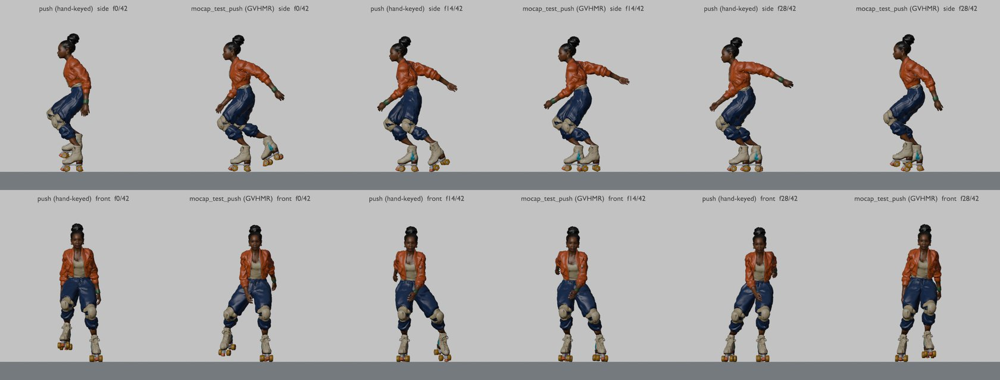

# GVHMR video mocap test: ready for a Colab run

Date: 2026-11-21. Branch: `claude/wizardly-mayer-binhnd` from `main`.

## Result

- **Not run yet. The GPU step is ready for Google Colab.** The cloud session has no CUDA GPU (see "Environment check"). The owner has Colab Pro. The notebook `scripts/mocap/gvhmr_colab.ipynb` runs all steps on a Colab GPU and copies the outputs to Google Drive.
- All the steps after the GVHMR estimate run on a CPU, and they were tested in this session with Blender 5.1.2. GVHMR itself (the estimate) was not run.
- No money was spent. No shipped clip changed. The clip table in `scripts/blender/nia_clips.py` did not change.
- **The pipeline cannot be used for a shipped clip.** GVHMR and SMPL-X are for non-commercial research only. See "Licenses".
- There is no mocap clip yet. Thus this report does not yet say if mocap is better or worse than the hand-keyed `push` clip. That comparison comes after the Colab run.

## How to run (owner)

1. Register at `smpl-x.is.tue.mpg.de`, accept the license, download SMPL-X v1.1 (NPZ+PKL), and put `SMPLX_NEUTRAL.npz` in Google Drive at `MyDrive/skate-atl-mocap/`. An agent cannot accept this license for the team.
2. Open `scripts/mocap/gvhmr_colab.ipynb` in Colab. Set a GPU runtime (T4 is sufficient).
3. In cell 1, set the video: a Wikimedia Commons file (`COMMONS_FILE`) or a Pexels video (`PEXELS_*`), and `T0`, `T1`. Cell 7 lists Commons candidates with their license, creator, size, and length. Use one skater, full body, steady camera, side or front view, 5 to 15 s.
4. Run all. The outputs go to `MyDrive/skate-atl-mocap/out/<time>/`.

Cell 8 stops if the license is not CC0, public domain, CC BY, CC BY-SA, or the Pexels license.

## Steps of the run

| Step | Where | Tool | Tested here |
|---|---|---|---|
| 1. Install GVHMR (Python 3.10 venv, torch 2.3.0+cu121, pytorch3d 0.7.6) | Colab GPU | `uv` with `scripts/mocap/gvhmr-requirements-lock.txt` | Pins resolve for Linux, Python 3.10 (PyPI). The CUDA wheels and pytorch3d hosts are blocked here. |
| 2. Checkpoints (5.3 GB) and SMPL-X | Colab | Hugging Face mirror; SMPL-X from your Drive | No (host blocked here) |
| 3. Video: license check, trim, 30 fps | Colab | Commons API or Pexels, `ffmpeg` | No (host blocked here) |
| 4. GVHMR estimate | Colab GPU | `pipeline/estimate_pose_gvhmr.py --smplx-only` | No (no GPU) |
| 5. Nia rig profile | CPU | `scripts/mocap/nia_rig_profile.py` | Yes |
| 6. Retarget, support foot "none" | CPU | `pipeline/retarget_smplx.py` with the spec of cell 10 | Profile loads in the `Rig` class. The retarget itself needs `smplx.npz`. |
| 7. In place, wheel lock, loop, bake, GLB | CPU | `scripts/mocap/nia_mocap_clip.py` | Yes, on test data |
| 8. Comparison renders and metrics | CPU | `scripts/mocap/nia_mocap_compare.py` | Yes, on test data |
| 9. Optional overlay on the video | CPU | `pipeline/render_review.py` | No |
| 10. Provenance and copy to Drive | Colab | cell 14 | No |

### Nia on a Mixamo pipeline

The retarget expects a Mixamo FBX import: a Y-up armature space, the character facing +Z, and the armature object turned +90° about X. After a GLB import, the armature of Nia has no transform: Z-up, facing −Y, left foot at +X. `nia_rig_profile.py` writes each bone rest matrix multiplied by Rx(−90°) and gives the armature world matrix as Rx(+90°). This is the Mixamo convention at a scale of 1. A constant turn of the full armature space does not change the local rotation of a bone relative to its parent. The retarget writes the hips location in the hips bone frame. Thus `motion.npz` applies to the real rig without a change. Check in this session: 65 bones, the toes go to +Z, the floor (the lowest wheel point) is at 0.000 m, and the pipeline's `Rig` class loads the profile.

### Support foot "none"

The SMPL-X path of the pipeline does not use the `plant` list of the spec. It finds the contacts from the video in five ways. The spec of cell 10 turns all five off:

| Contact source | Setting |
|---|---|
| GVHMR static flag | `contact_threshold: 1.01` |
| Slow foot near the floor | `contact_max_speed: 0.0` |
| Foot still on the screen | `contact_still_px: 0.0` |
| Single support (one foot high, the other low) | `contact_swing_height: 10.0` |
| Foot still on the known floor | `contact_geo_speed: 0.0` |
| Body correction from static feet | `pin_static_feet: false` |

`floor_snap` stays on. It moves a free foot down to the floor in height only, so it does not stop the skate. With no contacts, the root follows the camera estimate (`camera_footfalls`, documented in the pipeline).

### In place, wheel lock, loop

`nia_mocap_clip.py` does these steps:

1. It finds the loop window: two frames 1 to 3 s apart with the nearest pose (legs, spine, arms) and speed.
2. It removes the linear heading drift and the linear root travel over the window. The body sway about that line stays.
3. It blends the last 6 frames into the frames before the loop start, so the last frame is equal to the first frame.
4. It puts the lower skate on the ground with the hips height, smoothed over 2 frames.
5. It moves each ankle with a two-bone leg IK. A skate under the ground comes up. A skate less than 1.5 cm above the ground goes down to it. Between 1.5 cm and 4 cm the pull fades out. The foot keeps its world rotation, so the skate moves as one rigid part.
6. It bakes one key on each frame for each bone (no constraints), and exports a Draco GLB with only this clip.

### CPU test on test data

`scripts/mocap/make_test_motion.py` makes a `motion.npz` from the shipped `push` clip, 5 loops. It adds the faults of a capture: 3 m/s travel, a heading drift of 8°/s, rotation noise of 1.5° on each bone, and a sink of 2.5 cm. This is not mocap. It only tests the scripts.

Result (`2026-11-21-gvhmr-mocap-test/cpu-test-clip-report.json`):

- Loop found at the period of the source (42 frames, 1.75 s). Travel and heading drift removed.
- Before the wheel lock, the lowest skate was 2.3 to 5.7 cm under the ground. After it, the lower skate is at 0.000 m on all 42 frames. 18 skate frames were lifted and 51 were lowered, by 2.2 cm at most. No leg was at full reach.
- GLB: 2,154,616 bytes.

Metrics (`2026-11-21-gvhmr-mocap-test/cpu-test-metrics.json`, skid at 3 m/s):

| Clip | Penetration | Hover frames | Jitter (m/s²) | Skid mean / p95 (m/s) | Loop seam (m/s) |
|---|---|---|---|---|---|
| `push` (hand-keyed, shipped) | −0.03 cm | 0 | 6.9 | 0.51 / 1.15 | 0.82 |
| test data (push + noise) | 0.00 cm | 0 | 29.4 | 0.66 / 1.82 | 2.48 |

The metrics find the added noise: the jitter is 4 times higher, and the loop seam is 3 times higher. The wheel lock removes the sink. Use the same metrics on the real mocap clip.

## Environment check (this session)

| Check | Result |
|---|---|
| `nvidia-smi` | `command not found`. No NVIDIA driver, no CUDA. |
| GPU | None. CPU: 4 cores. Memory: 15 GB. |
| Blender | 5.1.2 installed from `download.blender.org` for the CPU tests (the pipeline was validated on 5.1.2). |
| `huggingface.co`, `smpl-x.is.tue.mpg.de`, `commons.wikimedia.org`, `download.pytorch.org`, `dl.fbaipublicfiles.com` | Blocked by the network policy (proxy `403`). Colab can reach them. |

Workbench renders need EGL. This session installed Mesa (`libegl1`, `libgl1-mesa-dri`). Cell 4 of the notebook installs the same packages.

## Licenses

Commits used: `squall01337/mixamo-llm-mocap` at `da5e7cc48557f0272832429a8df3fbf2b3c1273d` (2026-09-26) and `zju3dv/GVHMR` at `ee960bb6e2ea2d381aa97f08e9b71ef320b624b1` (2026-09-15). Both are older than 7 days. The GVHMR commit is the revert of "Adopt Project Registration License v1.0"; the `LICENSE` file at this commit is the original GVHMR license.

| Part | License | Commercial use |
|---|---|---|
| `mixamo-llm-mocap` code | MIT (the `LICENSE` file). | Yes. |
| GVHMR code (`zju3dv/GVHMR`) | Custom: "educational, research and non-profit purposes only". Modifications must be open source and "prohibited for commercial use". | **No.** Commercial use needs written permission from the authors (contact in the `LICENSE` file). |
| GVHMR checkpoint `gvhmr_siga24_release.ckpt` | No separate license. The pipeline README says "Its pretrained checkpoints carry their own terms". Treat it as the GVHMR license. The notebook gets it from `huggingface.co/camenduru/GVHMR`, an unofficial mirror, and records its sha256. | **No.** |
| SMPL-X body model (`SMPLX_NEUTRAL.npz`) | MPI license, registration required. Non-commercial scientific research only. A commercial license is sold separately (Meshcapade). Not read again in this session (site blocked). | **No.** A person must register and accept the license. |
| HMR2.0 checkpoint (4D-Humans) | Code: MIT. The weights output SMPL, so the SMPL license also applies to their use. | Code yes; model use limited by SMPL. |
| ViTPose-H checkpoint | Apache-2.0 (code). The weights are trained on COCO. | Code yes. |
| YOLOv8x checkpoint (Ultralytics) | AGPL-3.0. | Only under AGPL-3.0, or with a paid Ultralytics license. |
| MediaPipe Pose and Hand Landmarker | Apache-2.0. | Yes. |
| Blender | GPL-3.0-or-later. Output files are not covered by the GPL. | Yes. |
| Rig of Nia | From Tripo (`assets/skaters/nia/provenance.json`), not a Mixamo download. The Mixamo terms do not apply. | Yes. |
| Test video | Recorded at run time in `video_source.json` and `provenance.json` (URL, creator, license). | Per its license. |

### Why GitHub reports `NOASSERTION`

The `LICENSE` file of `mixamo-llm-mocap` starts with the full MIT text. Then it adds a "Third-party notes" section (Mixamo, GVHMR, SMPL-X, pytorch3d, Blender MCP). The extra text stops GitHub's license detector from matching the file to MIT exactly. The code itself is MIT.

### License limit for Skate ATL

The goal is the official game of the City of Atlanta. A clip made with this pipeline is an output of GVHMR and SMPL-X. Thus:

1. Use the output for an internal test only. Do not ship it.
2. Before any shipped clip, get written permission from the GVHMR authors and a commercial SMPL-X license, or use a solver with a commercial license.

The notebook keeps `smplx.npz`, `motion.npz`, and the overlay video in Drive only (`drive-only/`). Only the GLB, the metrics, the renders, and the provenance are for git.

## After the Colab run

Claude reads `MyDrive/skate-atl-mocap/out/<time>/` with the Google Drive connector. Then:

1. Put `mocap_test_push.glb`, `clip_report.json`, `compare/`, `video_source.json`, and `provenance.json` in `assets/skaters/nia/mocap-test/`.
2. Add the metrics and the comparison sheet to this report, with the foot sliding, the jitter, and the wheel penetration.
3. Say plainly if the mocap clip is worse than the hand-keyed clip.

## Known risks of the run

- The install of GVHMR on Colab was not tested end to end. The pins resolve, but the CUDA wheels, pytorch3d, and the checkpoints were not downloaded here.
- The retarget with all contacts off was not run (no `smplx.npz`). The pipeline supports zero contacts (the root then follows the camera), but a skate video is a new case for it.
- GVHMR was trained on walking and other motion on foot. A skate glide has no foot steps, so its root and foot estimates can be poor. The loop window and the wheel lock hide some faults; the metrics and the overlay show them.
