# MetaHuman Nia from a bare body, clothed after the conform

Date: 2026-11-27. Branch: `claude/nia-mh-bare-body-8e1b6d`. This spike follows the first MetaHuman spike, [2026-11-27-metahuman-nia-spike.md](2026-11-27-metahuman-nia-spike.md) (PR #412). That spike measured the browser cost on a proxy (the Crossroads Duke). This spike makes a MetaHuman of Nia herself.

## Result

1. **Conform: PASS on attempt 4 of 5.** The MetaHuman fits the bare Tripo Nia. `check_fit.py` (Crossroads) passes all 38 checks. Face landmark mean: 1.67 mm (limit 2). Surface mean: 0.90 mm, p95 4.21 mm (limits 2 and 6). Tip error: 3.13 mm at most (limit 5).
2. **Auto-rig: DONE.** The Epic cloud gave the head DNA (49.0 MB, 875 joints, 695 head shapes) and the body DNA (4.5 MB, 342 joints).
3. **Clothes: on the MetaHuman, with copied weights.** Jacket, joggers and skates are Tripo Smart Mesh models from images in the same pose. The crop top, the knee pads and the wristband are made in Blender. The hair bun comes from the shipped Tripo Nia. The body under the cloth is hidden.
4. **Bake-down and browser: PASS on cost, FAIL on look.** The high-tier GLB is 5.86 MB (shipped Nia: 5.90 MB), 65,398 triangles, 79 bones, 52 face morphs. It holds 60 FPS (vsync on) in `skater.html` and on the BeltLine high tier; with vsync off the BeltLine frame went from 5.3 to 5.7 ms mean. The clips show three visible faults: the bare feet beside the skate boots, skin through the joggers in the crossed-leg grind, and a crop top that shows the body form. The skin has no texture.
5. **Credits: 485 of the 500 cap.** One step cost more than its button price (Smart Mesh: 125 charged, 100 shown). The owner approved the rest at 125 each.

The shipped Nia did not change. No file under `assets/skaters/nia/` or `src/` changed.

## Credit ledger (Tripo Studio)

| Step | Button price | Charged | Balance after |
|---|---|---|---|
| Start | | | 22,434 |
| 9 Nano Banana Pro image edits (bare body, dressed sheet, 5 garments, 2 retries of the crop top, 1 failed wristband) | 0 (20 struck through) | 0 | 22,434 |
| HD Model, bare body (4k texture, no PBR, 500,000 faces) | 55 | 55 | 22,379 |
| HD Model, head crop (60,000 faces) | 55 | 55 | 22,324 |
| Smart Mesh, jacket (quad, 10,000, texture) | 100 | **125** | 22,199 |
| Stop: the charge was more than the button price. The owner approved 125 for each of the next two. | | | |
| Smart Mesh, joggers | 100 | 125 | 22,074 |
| Smart Mesh, skates | 100 | 125 | 21,949 |
| 5 GLB exports from the canvas (4k) | none shown | 0 | 21,949 |
| **Total** | | **485** | |

Crossroads saw the same gap on Smart Mesh (100 shown, 110 charged). Treat the Smart Mesh button price as a lower limit.

## Images (Tripo Studio canvas, Nano Banana Pro)

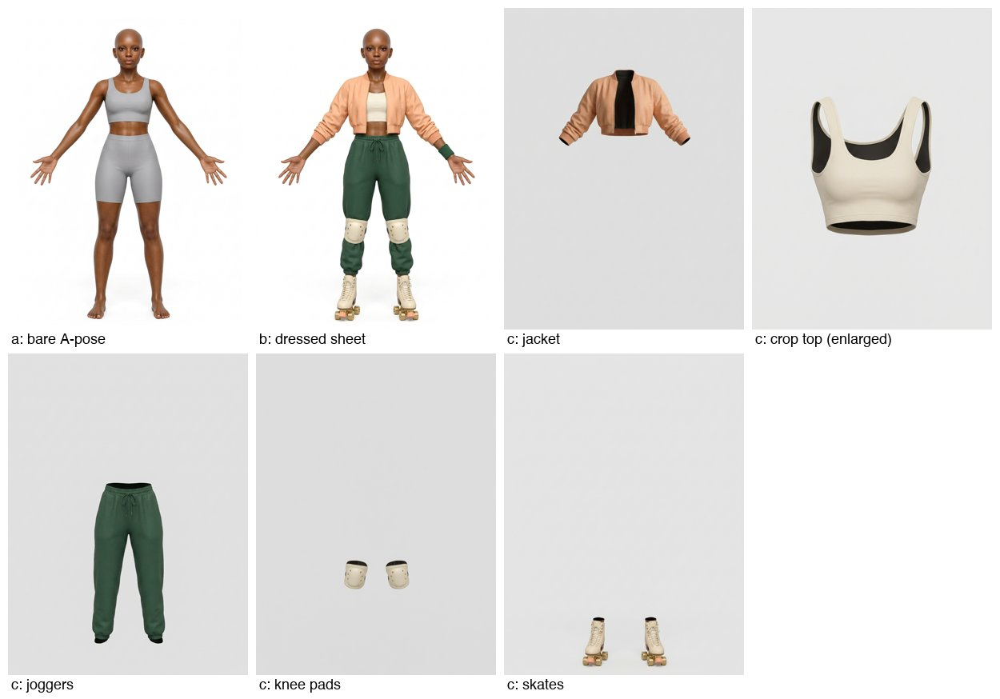

Files and prompts: `docs/characters/concept/nia-mh-bare/` and its `provenance.json`.

1. **(a) Bare Nia**: A-pose, open hands with the fingers apart, bare feet, no hair and no brows, a plain gray sports top and bike shorts.
2. **(b) Dressed sheet** from (a): the same frame. Its bounding box is the same as (a) to the pixel (x 84–816, y 77–1161; the skates go to y 1170).
3. **(c) One image for each garment**, with the hollow-shell wording of the Crossroads prompt (A-pose in place of T-pose):
   - The jacket, the joggers, the knee pads and the skates stayed at their place in the frame.
   - The crop top came out enlarged and centered on all 3 tries (a small garment under the jacket). Its 3D part does not use this image (see "Clothes").
   - The wristband failed: the result kept the whole woman and added a large tube.

Owner approval: all images on 2026-11-27, before any 3D generation.

## 3D sources

| Model | Faces | Notes |
|---|---|---|
| Body, HD | 473,348 | 4096 px base color |
| Head, HD, from a 768 px crop of (a) | 58,184 | in the 48,000–70,000 range |
| Jacket, Smart Mesh | 19,597 | the open front came out as a closed dark panel |
| Joggers, Smart Mesh | 20,773 | |
| Skates, Smart Mesh | 19,417 | wheels fused to the plates |

Raw GLBs: `assets/skaters/nia-mh/raw/` (not in git, 3.3–25.2 MB). Ledger and settings: `assets/skaters/nia-mh/provenance.json`.

## Conform (UE 5.8 on the Mac)

### Fit target

`scripts/blender/research/nia_mh_fit_prep.py`:

1. Scale the body to 1.70 m (the shipped Nia height) and center it.
2. Align the HD head to the head of the body with a scaled ICP. The mean residual went from 5.37 mm to 1.85 mm.
3. Cut the body at the neck (z 1.462 m) and put the aligned head there.
4. Decimate the body part to 200,000 faces. Target: 116,095 vertices, 232,162 faces.
5. Render the front portrait with the Crossroads camera (0.75 m, 40° horizontal field of view, 1024 px).

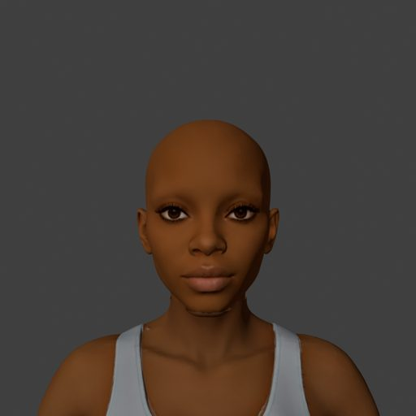

### Attempts

The stages are the fighter-neutral Crossroads scripts in `~/Development/crossroads-unreal-stages/pipeline/metahuman_fit/`: `unreal_stage.py conform`, `fit_import.py`, then `unreal_stage.py autorig`. The project is `CrossroadsFit.uproject` with the `CrossroadsFitTools` plugin. The measurement is `scripts/blender/research/nia_mh_measure.py` (the Duke `measure.py` with the heights scaled by 1.70/1.80), MediaPipe 0.10.21 for the face landmarks, then Crossroads `check_fit.py` with the agreed `tolerances.json`.

| Attempt | Key points | Failed checks | Face mean (mm) | Surface mean / p95 (mm) | Largest tip error (mm) |
|---|---|---|---|---|---|
| 1 | none | 4: eye outer L 4.80, eye outer R 4.72, chin 6.03, face mean 2.94 | 2.94 | 0.91 / 4.24 | 2.94 |
| 2 | 5 face (eye corners, chin) | 3: ring R 15.09, pinky R 25.06, index–middle gap R 0.24 | 1.66 | 1.05 / 4.81 | 25.06 |
| 3 | 5 face + 20 finger | 5: thumb L 5.99, thumb R 6.56, ring R 5.09, wrist L and R ratio 0.035 / 0.032 | 1.66 | 1.12 / 5.33 | 6.56 |
| 4 | 5 face + 20 finger (thumb rule fixed) | **0 (PASS, 38/38)** | 1.67 | 0.90 / 4.21 | 3.13 |

Two faults in the adapted tools, found and fixed:

1. **Finger labels (attempt 3).** The Duke `finger_pins.py` takes the thumb as the tip nearest the body center. In Nia's A-pose the palms face forward, and the thumb is on the outer side. The attempt-3 pins pulled the fingers by 87.3 mm on average. The fixed rule takes the tip with the smallest reach along the hand axis. The attempt-4 pins are 6.8 mm on average from the good hands of attempt 1.
2. **Neck ring (attempts 3 and 4).** The Duke slab ring read the neck 15 % thin because its center drifted to the chin. At fixed heights the fit neck matches the target: 350.6 against 350.8 mm at z 1.44 m. The script now uses a true plane section, as the Duke lesson says for the ankles. No tolerance changed. The table above uses the fixed ring for all 4 attempts.

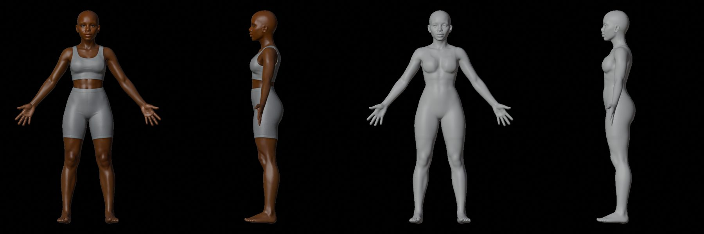

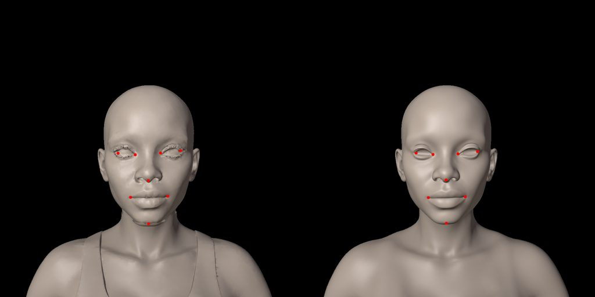

The 4 conform runs took about 2 minutes each. Save Pose ran in each conform (`commit_posed_state_as_a_pose`). The auto-rig ran once, on attempt 4, after the owner signed in to Epic.

Files: `2026-11-27-metahuman-nia-bare-body/fit/` (key points, conform reports, measurements, `check_fit` output for each attempt).

## Clothes on the MetaHuman

`scripts/blender/research/nia_mh_clothes.py` works on the Save Pose mesh (`posed_combined_lod0_mesh`, 54,412 vertices) and its body rig.

1. **Place by the sheet.** 1 px = 1.565 mm (the body height of image (a) maps to 1.696 m). Each garment box in its image gives its place and size. The joggers image is 80 px longer than the worn joggers of the sheet, so the joggers take their height from the sheet (472–994 px).
2. **Measure before any fit work** (the Crossroads measure: the share of garment points inside the body).
3. **Remove the dark front panel** of the jacket (1,638 faces with a near-black texture in the open front).
4. **Push out** the cloth points that are inside the skin, or closer than 6 mm, to 6 mm outside. Then smooth 2 steps.
5. **Copy the body weights** (nearest face, interpolated).
6. **Hide the body under the cloth**: a Mask of the covered skin (a short ray out along the skin normal hits a garment).
7. **Shrinkwrap only the openings**: the vertices within 15 mm of the boundary loops longer than 0.12 m, 4 mm offset.

| Garment | Inside the body, placed only | Inside after the push-out | Mean distance to the body (mm) |
|---|---|---|---|
| Jacket | 13.84 % | 0.52 % | 24.85 |
| Joggers | 57.12 % | 0.80 % | 8.97 |
| Skates | 30.39 % (feet in the boots) | not pushed | 22.48 |

The joggers number agrees with the Crossroads finding: a garment from a front image is too thin at the back and the sides. Here the push-out moved 7,586 of the joggers points.

Parts made without credits:

- **Crop top**: the torso skin in the crop-top band of the sheet (y 315–428 px), 2.5 mm out. 1.83 % inside.
- **Knee pads**: two curved shells on the front of the joggers at the knee bones.
- **Wristband**: a tube on the left wrist (the image right side, as in the sheet), 12 mm above the hand bone.
- **Hair bun**: cut from the shipped Tripo Nia (`nia-real-tripo.glb`). Scaled ICP on the face and skull to the MetaHuman head (3.07 mm residual), then the points more than 4 mm outside the skull and above the ears. Weight 1 on `head`.
- **Skates**: weight 1 on `foot_l` / `foot_r`. The wheel points (the lowest 70 mm of each skate, 4 clusters per foot) go to 8 new bones `skate_wheel_<L|R>_<front|rear>_<a|b>` under the foot bones.

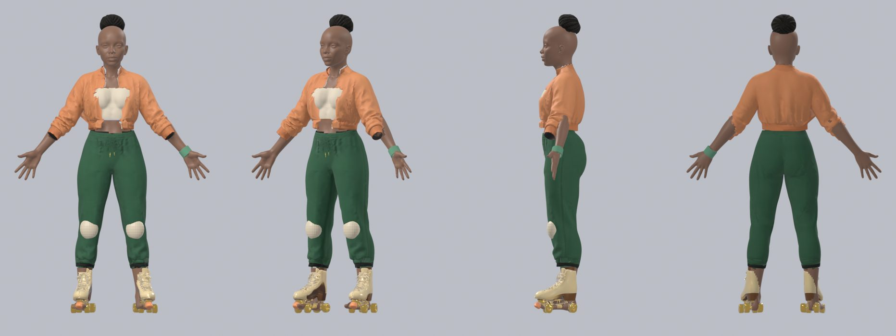

The skin is a flat color. The texture bake from the Tripo body to the MetaHuman UVs is not part of this spike.

## Bake-down

1. `scripts/blender/research/nia_mh_assemble.py` imports the head DNA and the body DNA with the Character DNA add-on and writes one GLB with both rigs and all 816 DNA shapes (the same layout as the Duke GLB of the first spike).
2. `scripts/blender/research/mh_bakedown.py` now takes `--garments <blend>` and `--wheels <json>`:
   - It appends the `garment_*` objects and deletes the body vertices under the cloth (11,550 of 32,334).
   - It collapses the garment weights to the 79 kept bones and decimates each garment (jacket 7,000, joggers 6,000, skates 7,000, crop top 1,500, knee pads 800, wristband 256, bun 714 triangles).
   - It puts the 8 wheel bones at the measured wheel centers, with weights.
3. The retarget of the 24 Mixamo clips is the same as in the first spike (scale 1.0191, largest rest correction 52.2° at the thumbs, 43.5° at the upper arms).

## The GLB files

| GLB | Size | Triangles | Vertices | Bones | Weights per vertex | Morphs |
|---|---|---|---|---|---|---|
| Shipped Nia, high (`b050f969`) | 5.90 MB | 33,789 | 27,494 | 73 | 4 | 0 |
| Shipped Nia, phone | 1.55 MB | 33,789 | 27,489 | 73 | 4 | 0 |
| Bare-body MetaHuman Nia, high | **5.86 MB** | **65,398** | 55,433 | **79** | 4 | **52** (+51 on the lashes, +2 on each eye) |
| Bare-body MetaHuman Nia, phone | **3.10 MB** | 65,398 | 55,433 | 79 | 4 | 0 |

Per-mesh numbers: `2026-11-27-metahuman-nia-bare-body/glb-stats.txt`. The garments add 24,268 triangles. The body is 24,999 triangles after the hidden skin is deleted.

## Browser measurement

`scripts/research/mh-spike-perf.mjs`, the same method as the first spike: a `dist` built from `b050f969`, the Nia GLB swapped at the network layer (`--match` points at the `b050f969` GLB), headless Chromium, ANGLE Metal, 1280 × 720, Apple M4 Max. One run per row.

| Run | Shipped Nia | Bare-body MetaHuman Nia | Change |
|---|---|---|---|
| BeltLine, high, PBR, vsync on | 16.7 ms (60 FPS) | 16.7 ms (60 FPS) | none |
| BeltLine, high, PBR, vsync off | 5.3 ms mean, 8.8 ms p95 | 5.7 ms mean, 10.5 ms p95 | +0.4 ms mean, +1.7 ms p95 |
| `skater.html`, vsync on | 16.7 ms (60 FPS) | 16.7 ms (60 FPS) | none |
| `skater.html`, vsync off | 1.4 ms | 1.4 ms | none |
| BeltLine draw calls / triangles at the end of the ride | 258 / 1,152,584 | 346 / 1,405,456 | +88 / +252,872 |

Read these numbers with the limits that follow:

- The BeltLine run is a worst case. The NPC skaters clone the same GLB, so some NPCs also became the MetaHuman. The +88 draw calls come from 13 meshes in place of 2 for each copy, and their shadow passes.
- The first spike (Duke proxy, no clothes, 6 meshes) gave +0.9 ms mean on the same ride. This run gave +0.4 ms. The two runs are single runs on different days; the difference between them is in the noise. Both are well inside the 16.7 ms frame.
- `skater.html` shows the bind pose and does not play a clip.
- No run had a page error or a console error.
- The viewer reports the first skinned mesh of the file (here the crop top, 1,500 triangles), so its `triangles` field is not the model total. Use the GLB table.

Result files: `2026-11-27-metahuman-nia-bare-body/browser/*.json`.

### Screenshots (browser, GPU)

| | Shipped Nia | Bare-body MetaHuman Nia |
|---|---|---|
| Front | 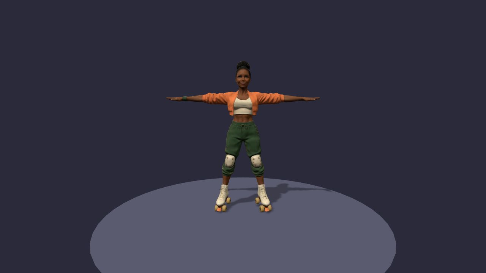 | 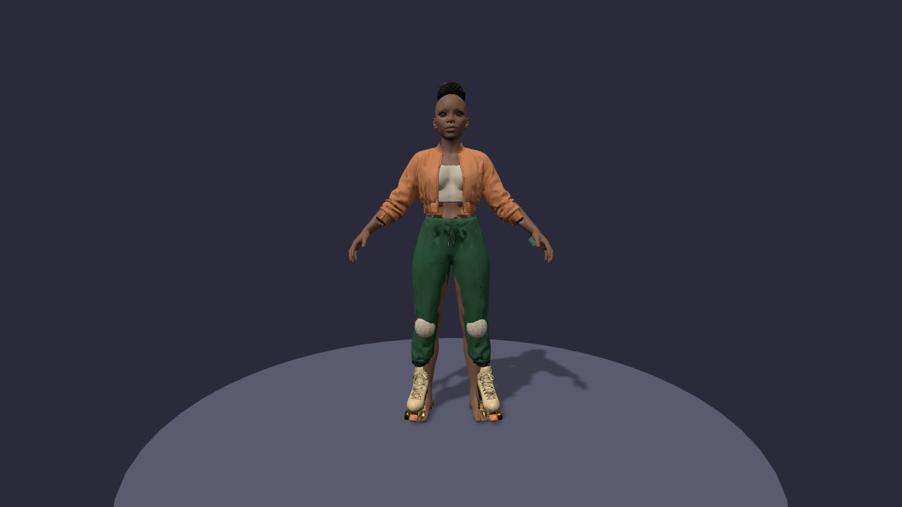 |
| Three-quarter | 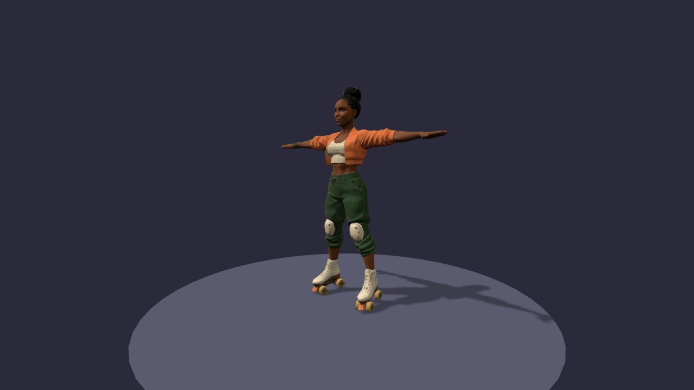 | 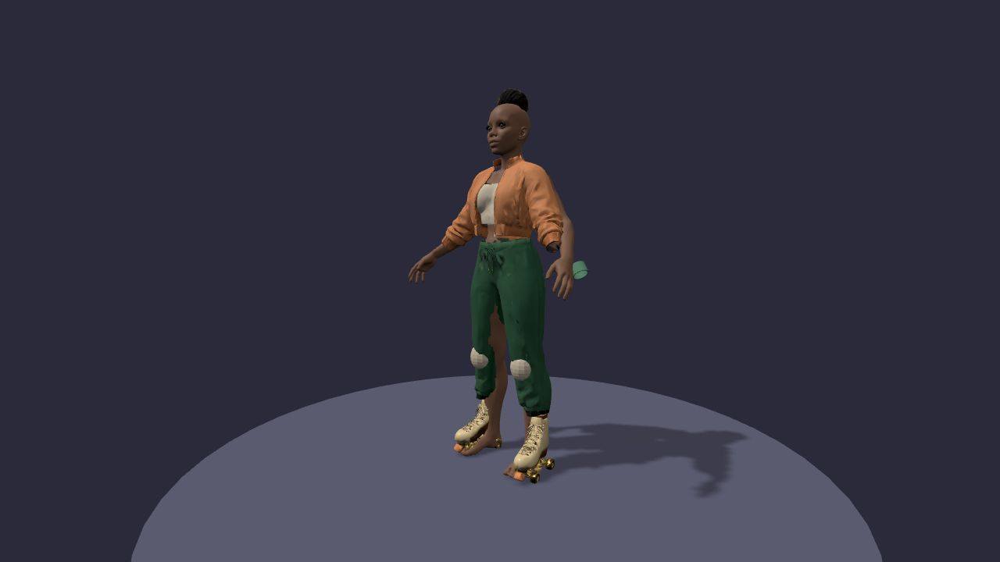 |
| Face view | 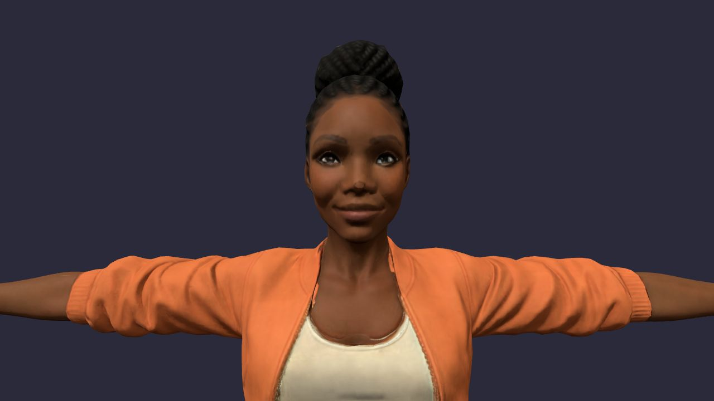 | 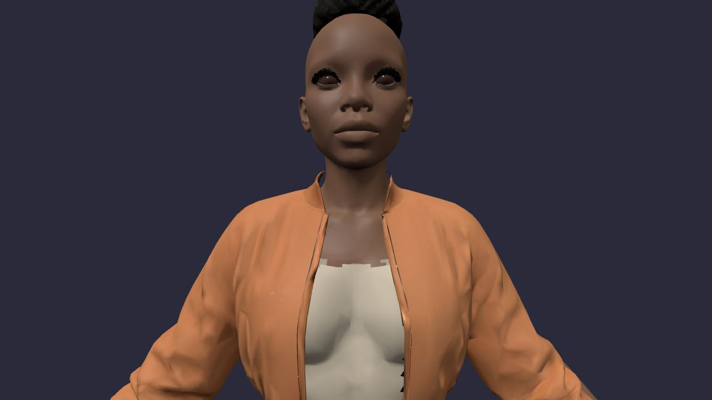 |
| `push` | 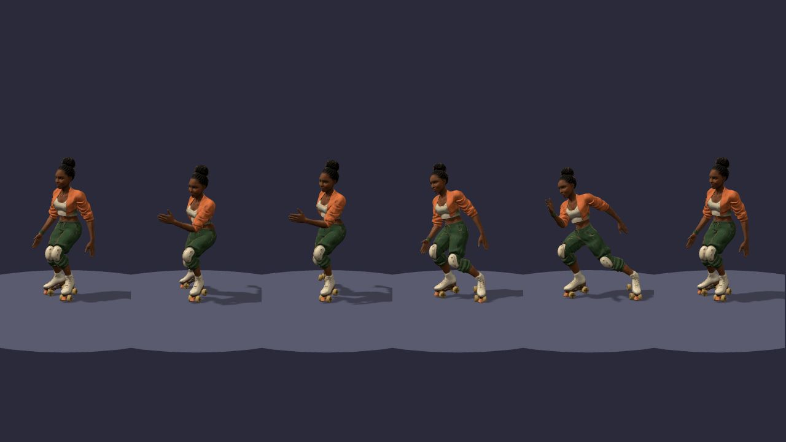 | 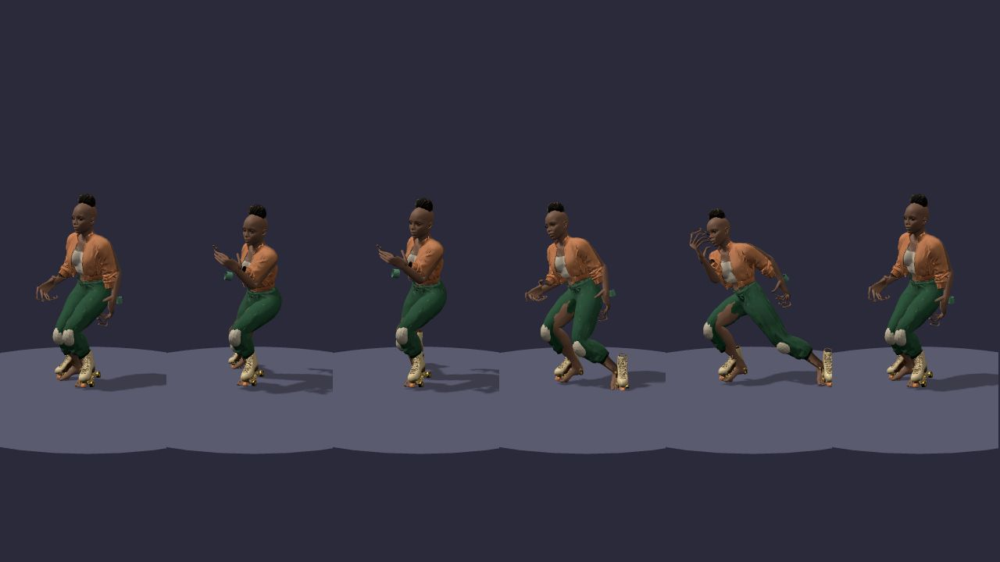 |
| `coast` | 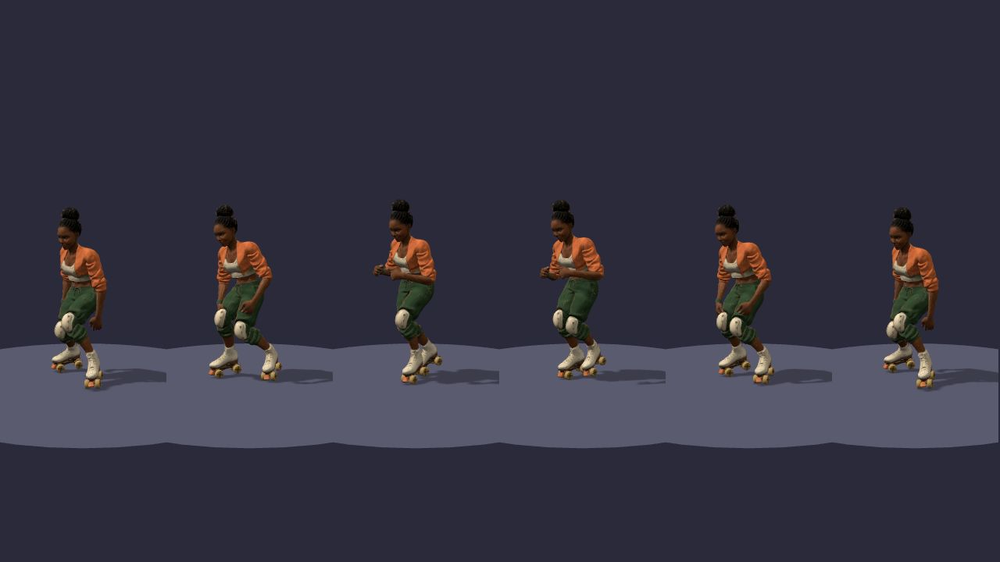 | 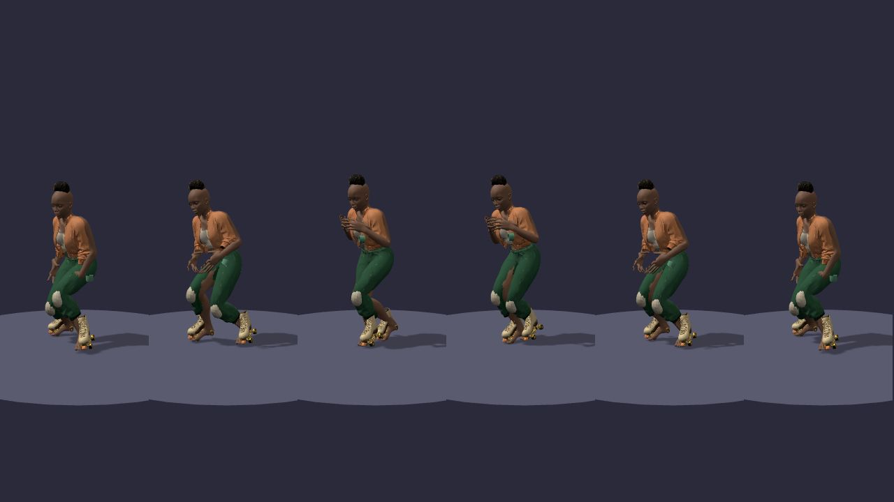 |
| `grind_soul` | 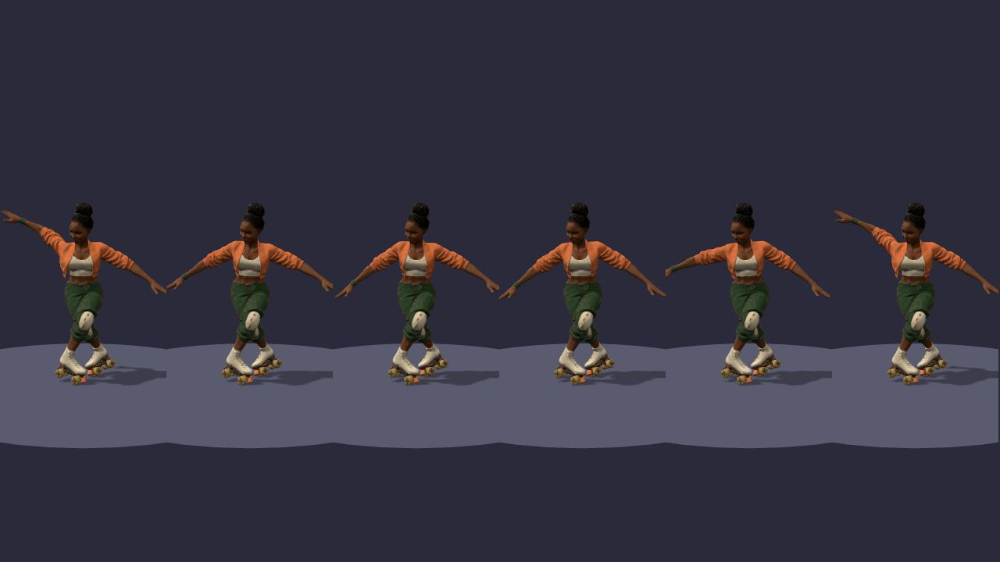 | 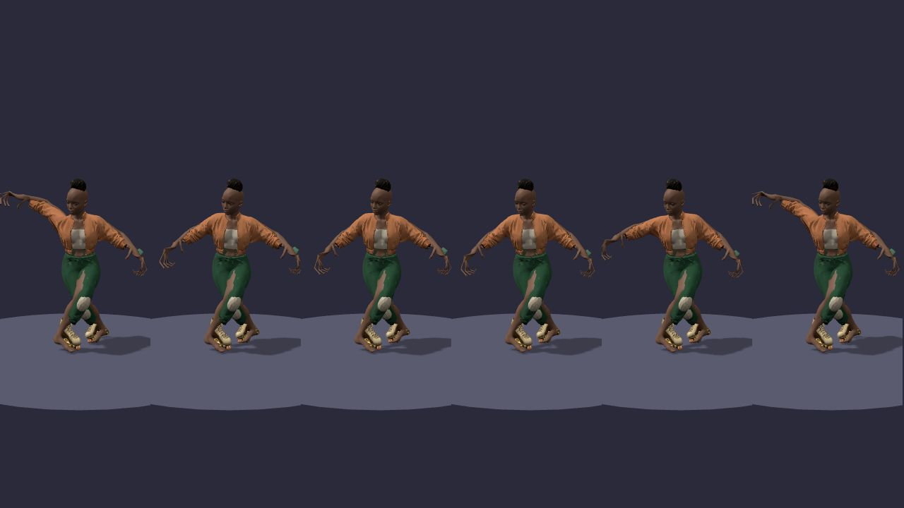 |
| `air_japan` | 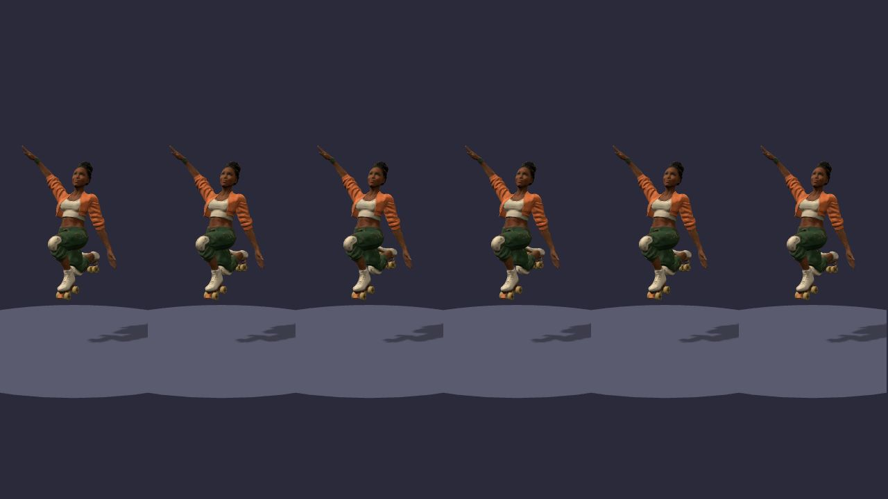 | 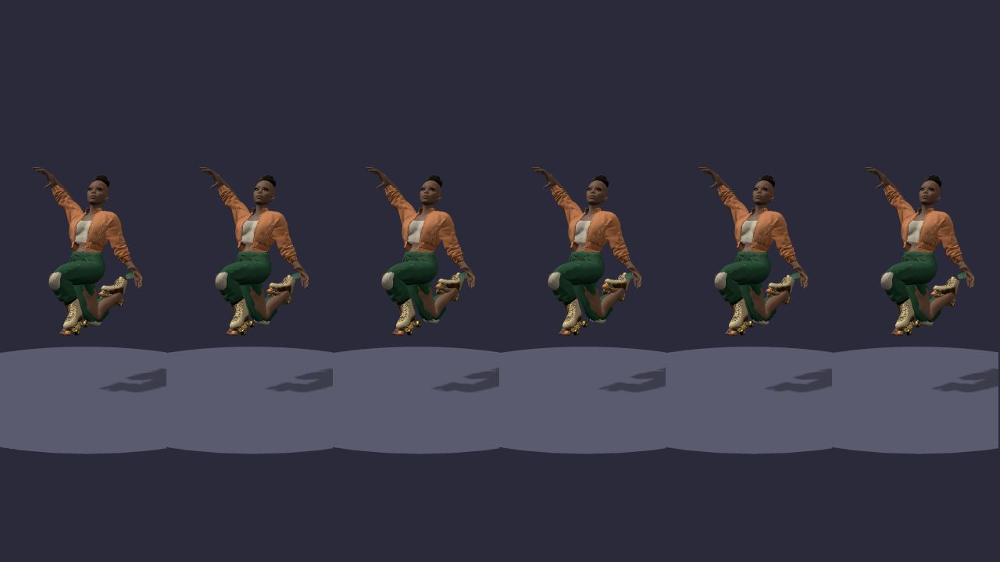 |
| BeltLine, high |  | 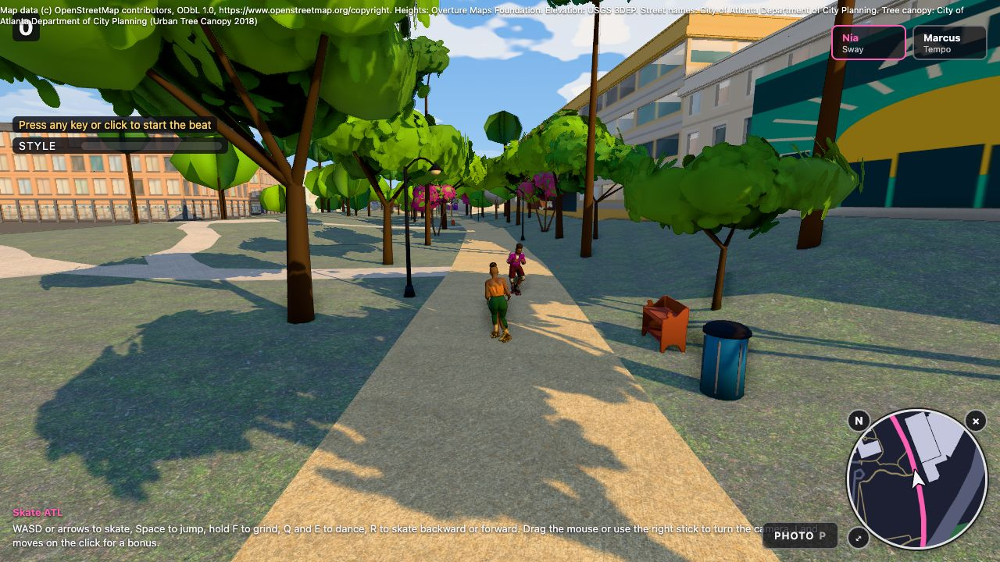 |

What the screenshots show:

- The clothed MetaHuman plays all clips in the game, with the jacket, the joggers, the skates, the knee pads, the wristband and the bun on her.
- **Fault: the feet.** In the crossed-leg `grind_soul` pose, the bare feet show beside the skate boots. The Tripo boots do not enclose the MetaHuman feet; they were placed by the image box only.
- **Fault: the joggers.** Skin shows through the inner leg of the joggers in `grind_soul`. The hidden-body step deletes only the skin that the cloth covers at rest.
- **Fault: the crop top.** It is the skin pushed out 2.5 mm, so it shows the body form, and its upper edge is jagged (face view).
- The face view frames the chest: the viewer frames the first mesh of the file.
- The skin and the face have flat colors (no texture bake).

## What is not done

- **Skin texture.** The MetaHuman has flat colors. A production bake must project the Tripo body and head textures to the MetaHuman UVs (Crossroads `bake.py`) and repaint the brows and lips.
- **Face quality.** The 52 morphs are sums of raw MetaHuman shapes, as in the first spike. A production bake must evaluate RigLogic for each ARKit pose.
- **Garment fit in motion.** The weights are copied from the body; no cloth simulation and no correctives. The faults in the clips (feet, inner leg, crop top) need: a boot fit to the MetaHuman foot (or the foot hidden inside a refit boot), a larger hidden-skin area under loose cloth, and a real crop-top garment.
- **The crop-top and wristband images.** Only the 3D parts made in Blender are in the build.
- **The neck seam** of the MetaHuman head and body is the same as in the first spike.
- **Review by skaters** of the move set (project rule) did not happen.

## Files

- Scripts: `scripts/blender/research/nia_mh_fit_prep.py`, `nia_mh_measure.py`, `nia_mh_face_pins.py`, `nia_mh_finger_pins.py`, `nia_mh_clothes.py`, `nia_mh_render.py`, `nia_mh_assemble.py`, `mh_bakedown.py` (extended), `scripts/research/mh_landmarks2d.py`.
- Images and provenance: `docs/characters/concept/nia-mh-bare/`, `assets/skaters/nia-mh/provenance.json`.
- Evidence: `docs/research/2026-11-27-metahuman-nia-bare-body/`.
- Not in git (size or source data): the raw Tripo GLBs, the DNA files (`~/Development/nia-fit/work-a04/rig/`), the assembled GLB (39.5 MB) and the baked GLBs (`~/Development/nia-fit/bake/`).

Commands to build again:

```bash
"/Applications/Blender 5.2.2.app/Contents/MacOS/Blender" -b --factory-startup -P scripts/blender/research/nia_mh_assemble.py -- ~/Development/nia-fit/work-a04/rig/head.dna ~/Development/nia-fit/assembled/nia-assembled-v01.glb
```

```bash
"/Applications/Blender 5.2.2.app/Contents/MacOS/Blender" -b --factory-startup -P scripts/blender/research/mh_bakedown.py -- --source nia-shipped-b050f969.glb --mh ~/Development/nia-fit/assembled/nia-assembled-v01.glb --garments ~/Development/nia-fit/clothed-a04/nia-mh-clothed.blend --wheels ~/Development/nia-fit/clothed-a04/clothes_report.json --out nia-mh-bare-high.glb --phone nia-mh-bare-phone.glb --report bakedown-report.json
```
