# MetaHuman face and body rig for Nia: browser cost spike

Date: 2026-11-27. Branch: `claude/friendly-clarke-1c8f89`. The measurements ran on the realistic Nia commit `b050f969`. That commit is on the local branch `feat/realistic-nia-wheels` only. It was not on `origin/main` when this spike ran.

## Result

1. **Browser cost: PASS.** A MetaHuman bake-down fits the high tier. The candidate GLB is 3.64 MB, with 42,132 triangles, 79 bones, 4 weights per vertex and 52 ARKit-named face morphs. It held 60 FPS (vsync) in `skater.html` and in the BeltLine Eastside on the high tier. With vsync off, the BeltLine frame went from 5.4 ms to 6.3 ms mean (+0.9 ms).
2. **Conform of Nia: NOT DONE.** The raw Tripo mesh `nia-real-tripo.glb` is not a valid conform target. It has clothes, skates, a hair bun, a T-pose and closed fingers. The Crossroads recipe requires a bare body in A-pose, with open fingers and no hair. The auto-rig step also needs an Epic sign-in on the Mac. See "Why the Nia conform did not run".
3. **The cost numbers come from a topology proxy.** Every conformed MetaHuman has the same head and body topology and the same skeleton. This spike used the conformed Crossroads Duke (`duke-assembled-v01.glb`) as the proxy. The screenshots show the body and face of Duke, not Nia.
4. **The face content is not production quality.** The 52 morphs are sums of raw MetaHuman shapes. Those shapes are RigLogic correctives of 8 mm or less. A production bake must evaluate RigLogic (joints and shapes) for each ARKit pose. See "Face bake-down".
5. **License: allowed, with conditions.** MetaHuman characters can ship in a Three.js game with no royalty. A developer with more than USD 1 million of annual gross revenue needs an Unreal Engine seat. MetaHuman data must not train AI. See "License".

The shipped Nia did not change. No file under `assets/` or `src/` changed.

## Method

1. `scripts/blender/research/mh_bakedown.py` (Blender 5.2.2, headless, 37 s) reads the shipped Nia GLB and the Duke MetaHuman GLB. It does these steps:
   1. It samples the 24 Nia clips (1,073 frames) in world space.
   2. It scales the MetaHuman to the Nia pelvis height (scale 0.9268).
   3. It keeps 71 MetaHuman deform bones, adds the jaw and the 2 eye bones from the head rig, and adds the 8 `skate_wheel_*` bones. Total: 79 bones.
   4. It moves the weight of each removed joint to the nearest kept ancestor, and keeps the 4 largest weights for each vertex.
   5. It builds the 52 ARKit shapes, then decimates the head to 5,120 vertices and the body to 25,000 triangles.
   6. It retargets the clips (see "Retarget plan") and adds a face track with all 52 morphs to each clip, so that the morphs are active during the measurement.
   7. It exports a high-tier GLB (2048 px WebP, Draco) and a phone GLB (1024 px, no morphs).
2. `scripts/research/mh-spike-perf.mjs` serves the built game and replaces the Nia GLB at the network layer (Playwright `page.route`). The shipped files do not change. It measures:
   - `skater.html`: the frame time for 5 s with the model in its bind pose, and screenshots.
   - The BeltLine Eastside, high tier, PBR look: the same 15 s trail ride as `scripts/perf.mjs`.
3. `scripts/research/glb-stats.mjs` reads the size, the vertices, the triangles, the morphs, the joints and the textures of a GLB.

Machine: Apple M4 Max, headless Chromium (Playwright 1.63.0), viewport 1280 × 720 at pixel ratio 1.

## Measurements

### The GLB files

| GLB | Size | Triangles | Vertices | Bones | Weights per vertex | Morphs | Textures |
|---|---|---|---|---|---|---|---|
| Shipped Nia, high | 5.90 MB | 33,789 | 27,494 | 73 | 4 | 0 | 4096 px base color |
| Shipped Nia, phone | 1.55 MB | 33,789 | 27,489 | 73 | 4 | 0 | 1024 px |
| MetaHuman bake-down, high | **3.64 MB** | **42,132** | 24,229 | **79** | 4 | **52** (+51 on the lashes, +2 on each eye) | 2048 px WebP, 0.53 MB in total |
| MetaHuman bake-down, phone | **1.98 MB** | 42,132 | 24,229 | 79 | 4 | 0 | 1024 px WebP |
| Duke MetaHuman, no bake-down (reference) | 62.97 MB | 122,540 | 65,471 | 359 + 875 | 8 | 816 | 2048 px PNG |

The parts of the high-tier bake-down:

| Mesh | Vertices | Triangles | Morphs |
|---|---|---|---|
| Body | 13,809 | 25,000 | 0 |
| Head | 5,120 | 9,833 | 51 |
| Teeth and tongue | 1,552 | 2,505 | 1 (`tongueOut`) |
| Lashes | 2,144 | 1,722 | 51 (the head deltas, carried over) |
| Eyes (2) | 802 each | 1,536 each | 2 each (from the source) |

The GPU memory of the morphs in three.js r186 is 16 bytes for each vertex for each morph (positions only, `WebGLMorphtargets`). The bake-down uses about 6.0 MB: head 4.2 MB, lashes 1.7 MB. The Duke head with no bake-down uses 271 MB (24,408 vertices × 695 morphs). The bake-down is necessary for this reason, and for the 63 MB download.

The high-tier bake-down is under the 6–10 MB target. The textures are 2048 px. 4096 px textures for the head and the body add about 1.5–3 MB (an estimate; not measured).

### Frame time

| Run | Shipped Nia | MetaHuman bake-down | Change |
|---|---|---|---|
| BeltLine, high, PBR, GPU, vsync on | 16.7 ms (60 FPS) | 16.7 ms (60 FPS) | none |
| BeltLine, high, PBR, GPU, vsync off | 5.4 ms mean, 9.1 ms p95 (186 FPS) | 6.3 ms mean, 11.8 ms p95 (159 FPS) | +0.9 ms mean |
| BeltLine, high, PBR, SwiftShader | 2,011 ms mean | 2,346 ms mean | +17% |
| `skater.html`, GPU, vsync on | 16.7 ms (60 FPS) | 16.7 ms (60 FPS) | none |
| `skater.html`, GPU, vsync off | 1.3 ms | 1.3 ms | none |
| `skater.html`, SwiftShader | 79.7 ms (12.5 FPS) | 138 ms (7.2 FPS) | +58 ms |
| BeltLine draw calls / triangles at the end of the ride | 258 / 1,152,584 | 291 / 1,221,050 | +33 / +68,466 |

Read these numbers with the limits that follow:

- The BeltLine run is a worst case. The NPC skaters clone the same GLB (`cloneSkaterModel`), so some NPCs also became the MetaHuman. The +33 draw calls come from the extra meshes of each copy: 6 meshes in place of 2, and their shadow passes.
- SwiftShader is a software GPU on the CPU. Its numbers are relative only. The `skater.html` SwiftShader samples are short (36 and 60 frames).
- The `skater.html` page shows the bind pose. It does not play a clip, so the viewer number includes skinning but not the mixer.
- The Duke MetaHuman with no bake-down also gave 1.3 ms in `skater.html` (vsync off). A static bind pose with all morphs at 0 does not show the cost of 816 morphs on this GPU. The download (63 MB) and the morph memory (271 MB) are the real limits.
- No run had a page error or a console error.
- Each row is one run. I did not repeat the runs.

Result files: `docs/research/2026-11-27-metahuman-nia-spike/*.json`.

## Screenshots

All screenshots are from the GPU runs. "Baseline" is the shipped Nia. "MetaHuman" is the bake-down of the Duke proxy.

| | Baseline | MetaHuman |
|---|---|---|
| Three-quarter view | 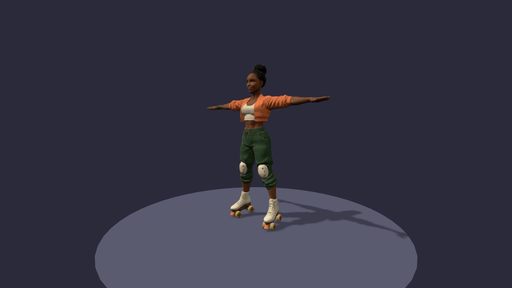 | 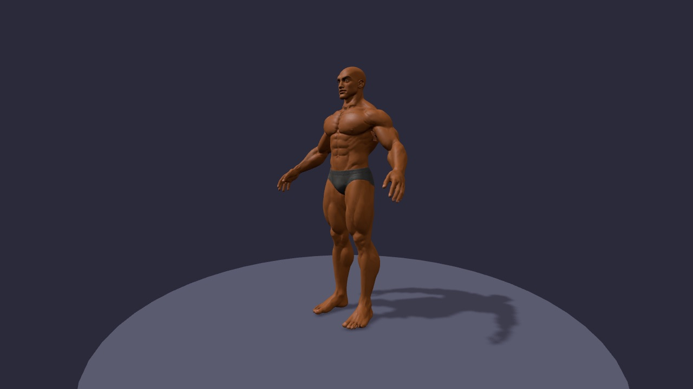 |
| Face view | 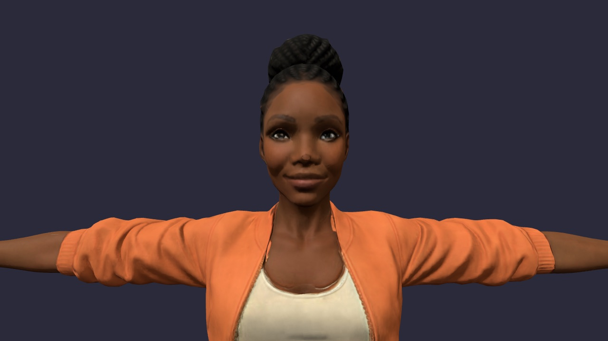 | 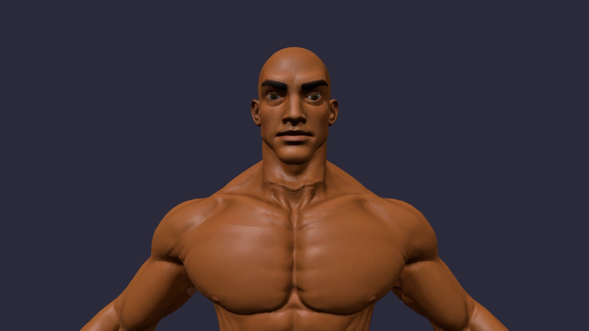 |
| `coast` | 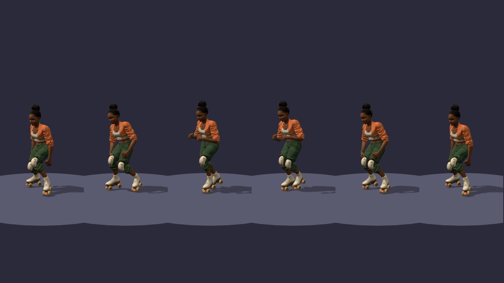 | 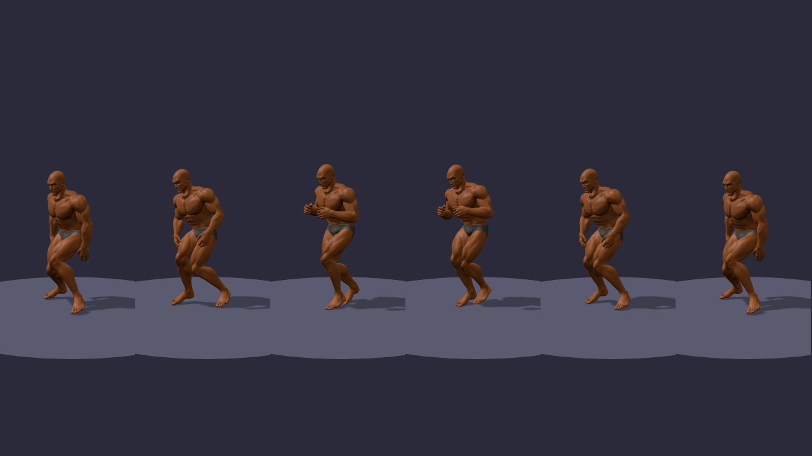 |
| `grind_soul` | 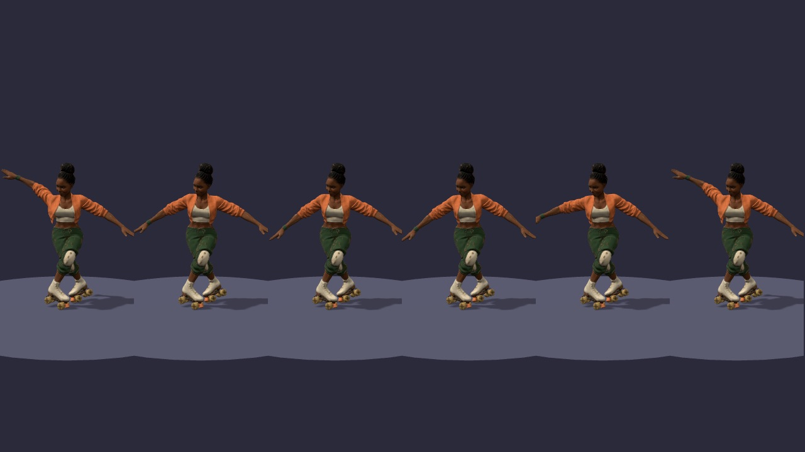 | 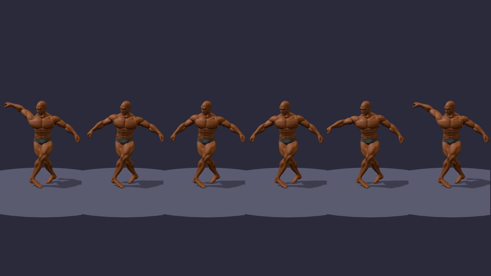 |
| `air_japan` | 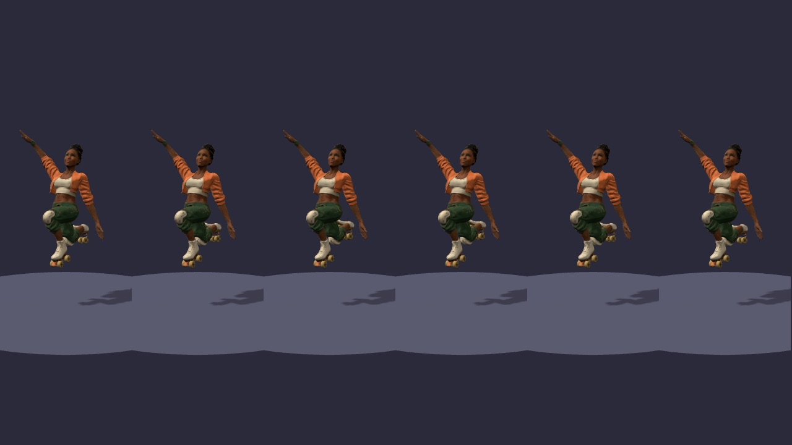 | 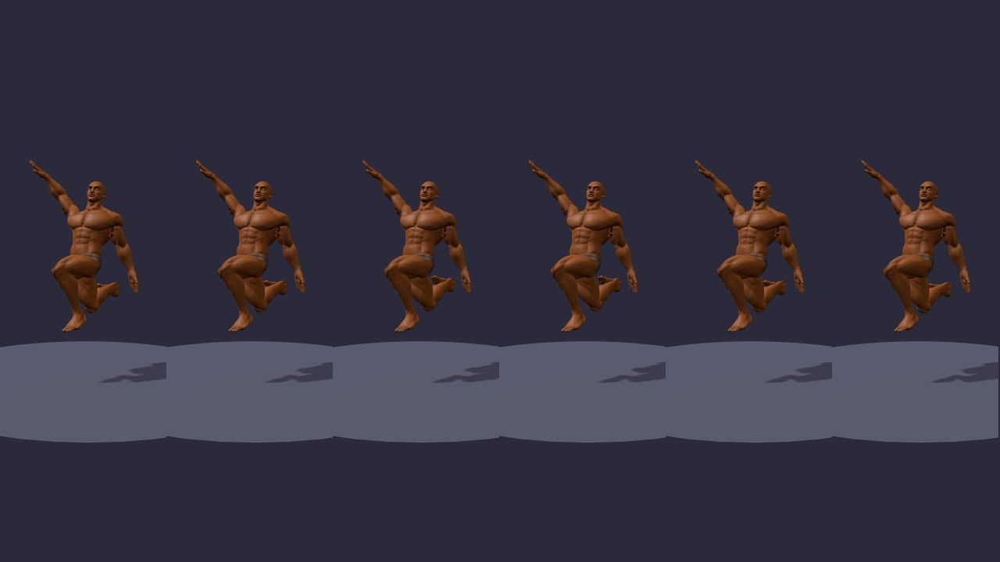 |
| BeltLine, high |  | 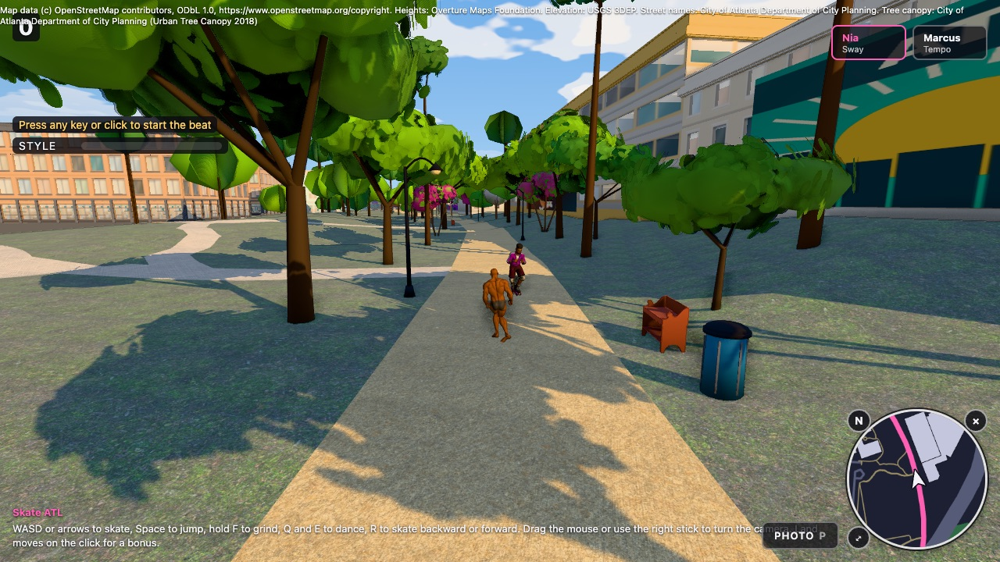 |

What the screenshots show:

- The retargeted clips keep the poses of the shipped clips (arms, legs, lean, crossed-leg grind).
- The face at 5,120 vertices keeps the eyes, the lips, the nose and the ears clear at the face view distance.
- The neck has a visible line where the body mesh and the head mesh meet. The Duke assembly has the same line. A production bake must fix the seam in the texture.
- The proxy has no skates. The feet stand flat. Skates for a MetaHuman must be a separate garment mesh.

## Why the Nia conform did not run

The source for a conform must follow the Crossroads recipe (`~/Development/crossroads/docs/pipeline/metahuman-stylized-character.md`, and the autonomous recipe in the `crossroads-stylized-metahuman-lab` skill). The raw Nia mesh does not meet 5 of its rules:

| Rule of the recipe | Raw Nia (`nia-real-tripo.glb`, 148,170 triangles) |
|---|---|
| Bare body, no clothes. The fit wraps the template around clothes and boots. | Jacket, top, sweatpants, knee pads, wristband |
| Bare feet | Roller skates with wheels |
| No hair. Hair breaks the skull shape. | Braided bun |
| A-pose, space at the armpits and the legs | T-pose |
| Open hands, fingers apart | Flat hands, fingers together |
| Separate head mesh of 48,000–70,000 faces | One mesh |

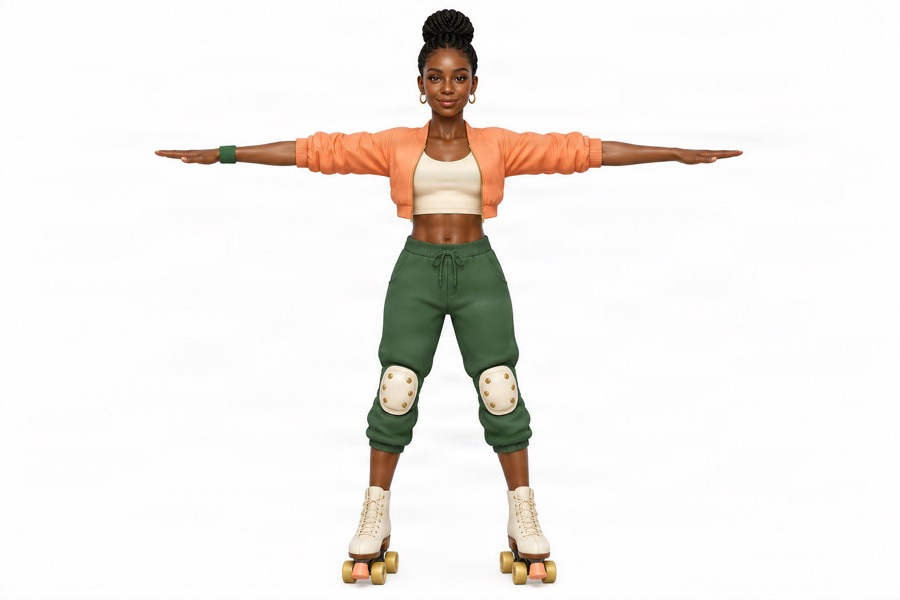

The Duke pilot shows the effect: "fitting the template to wrapped fists or boots is what broke Duke's earlier hands and feet" (Crossroads autonomous recipe, stage 2).

Two more items block an unattended run:

1. The auto-rig (`request_auto_rigging`, "Joints and Blend Shapes") runs in the Epic cloud. The owner must sign in to Epic in the Unreal editor on the Mac for each session.
2. Refine Vertices has no Python binding. Crossroads calls it through the `CrossroadsFitTools` editor plugin (`unreal.DukeFitRefineLibrary`). The Duke pilot needed 6 fit attempts to pass 37 checks.

## Face bake-down

Three.js cannot run RigLogic. The browser must get fixed morphs and a few bones.

What this spike did: each ARKit morph is the sum of 1 to 4 raw MetaHuman head shapes (the map is in `mh_bakedown.py` and in `bakedown-report.json`). The jaw and the eyes stay as bones. All 875 face joints except `FACIAL_C_Jaw`, `FACIAL_L_Eye` and `FACIAL_R_Eye` were collapsed into the head bone.

Why this is not enough: in a MetaHuman, most of the face motion comes from the 875 face joints. The raw shapes are correctives on top of the joints. The largest raw delta is 8 mm (`jaw_open`). Without the joints, a blink or a smile is too small.

The production bake must do these steps for each of the 52 ARKit poses:

1. Set the ARKit control values (Epic's ARKit mapping pose asset, or the Live Link ARKit curve map).
2. Evaluate RigLogic: the face joints and the shapes together. Use the Poly Hammer Character DNA add-on (OpenRigLogic) in Blender, which the Crossroads pipeline already uses.
3. Store the final deformed head minus the neutral head as one morph on the head LOD.
4. Do the same for the teeth, the lashes and the eyes (the eye bones keep the look directions).

Keep the jaw bone only if the clips need a jaw separate from `jawOpen`. Otherwise bake the jaw into `jawOpen` and remove the bone.

## Retarget plan (Mixamo clips to the MetaHuman skeleton)

`mh_bakedown.py` proves this plan on all 24 clips.

1. Map the bones by name:

   | Mixamo (`mixamorig:`) | MetaHuman |
   |---|---|
   | Hips | pelvis |
   | Spine, Spine1, Spine2 | spine_01, spine_03, spine_05 |
   | Neck, Head | neck_01, head |
   | LeftShoulder, LeftArm, LeftForeArm, LeftHand | clavicle_l, upperarm_l, lowerarm_l, hand_l |
   | LeftHand{Thumb,Index,Middle,Ring,Pinky}1–3 | {thumb,index,middle,ring,pinky}_01–03_l |
   | LeftUpLeg, LeftLeg, LeftFoot, LeftToeBase | thigh_l, calf_l, foot_l, ball_l |
   | (the same for the right side) | `_r` |

   The bones spine_02, spine_04, neck_02 and the twist bones follow their parents.
2. Align the rest poses. The MetaHuman rests in A-pose and Mixamo Nia rests in T-pose. For each limb bone, turn the MetaHuman bone about its head so that it points along the source rest direction. Do it from the root to the tips. The largest correction was 43.6° (upper arms).
3. For each frame, set the world rotation of each mapped bone to: source world rotation × inverse(source rest rotation) × aligned target rest rotation.
4. Move the pelvis by the source hip motion. The two skeletons have a similar height after the scale (0.9268), so no extra scale was necessary.
5. Convert the world matrices to local rotations and key them at 30 FPS. Keep the clip names, so that the game picks the clips with no code change.

Gaps to close before production:

- Drive `upperarm_twist_*`, `lowerarm_twist_*`, `thigh_twist_01` and `calf_twist_01` from the child rotation (for example 1/3 and 2/3 of the hand twist). Now they follow their parents, so a forearm twist can pinch.
- Keep the `ball` (toe) rotation flat when the skater wears skates.
- Add the skate garment and weight the boot to `foot` and `ball`, as `scripts/blender/skates.py` does for the shipped Nia. The wheel bones are in the skeleton, with no mesh.
- Check the hand contact with the knees in the dance clips. The MetaHuman arms are longer than the Mixamo Nia arms.

No game code reads Mixamo bone names. The only name rule is the `skate_wheel_` prefix (`src/render/skate-wheels.js`). The skeleton change needs no code change.

## License

Sources, read on 2026-11-27:

- MetaHuman license page and its FAQ: https://www.metahuman.com/license
- Unreal Engine EULA: https://www.unrealengine.com/eula/unreal

Findings:

1. MetaHuman is part of the standard Unreal Engine license. The tools are "Licensed Technology" under the Unreal Engine EULA (MetaHuman FAQ, "How much do I have to pay").
2. Use outside Unreal Engine is allowed. The FAQ says the EULA "provides for MetaHuman characters and animation to be used across all engines".
3. No royalty applies outside Unreal Engine. The FAQ classes MetaHuman characters and animation as Non-Engine Products. EULA section 4(a)(i) defines a Non-Engine Product as a product that includes no Engine Code and needs no Engine Code to run.
4. A seat is necessary above USD 1 million. The FAQ: a developer with more than USD 1 million of annual gross revenue that renders MetaHumans outside Unreal Engine needs an Unreal Engine seat. EULA section 6(b)(i): the revenue counts the whole corporate group, and includes advances and funds raised.
5. No AI training. The FAQ forbids the use of MetaHuman characters, animation curves or rendered output to train or test AI or machine learning.
6. The EULA also says "certain assets that we make available under separate agreements are available for use only with Unreal Engine". The MetaHuman FAQ puts MetaHuman characters outside that limit. Do not ship Epic sample assets (for example Fab content or Starter Content) without a check of their own license.

Item for the owner: the "official game of the City of Atlanta" can have a publisher or a developer with more than USD 1 million of revenue. That entity would need an Unreal Engine seat. This spike did not check who the licensee will be.

## What the production path costs

| Step | Where | Blocker |
|---|---|---|
| 1. Bare A-pose Nia source (body and a separate 48–70k face head) | Tripo, browser UI | Tripo credits (owner approval) |
| 2. Fit copy and portrait camera | Blender | none |
| 3. Conform, Refine Vertices, Save Pose | UE 5.8 on the Mac | about 6 attempts on Duke |
| 4. Auto-rig, DNA export | UE 5.8, Epic cloud | owner Epic sign-in |
| 5. Texture bake from the clothed Tripo model | Blender | none |
| 6. Clothes, hair bun and skates as garments | Blender | new garment meshes |
| 7. RigLogic ARKit face bake | Blender + Character DNA add-on | add-on install on this Mac (not checked) |
| 8. Bake-down and retarget (`mh_bakedown.py`) | Blender | none (proven here) |
| 9. Browser check | Playwright (`mh-spike-perf.mjs`) | none (proven here) |

## Files

- `scripts/blender/research/mh_bakedown.py`: the bake-down and the retarget.
- `scripts/research/mh-spike-perf.mjs`: the browser measurement.
- `scripts/research/glb-stats.mjs`: the GLB cost report.
- `docs/research/2026-11-27-metahuman-nia-spike/`: the screenshots, the result JSON and `bakedown-report.json`.

The candidate GLBs are not in git. They are built from the Crossroads Duke asset, which is not part of this repository. Run the script again to make them:

```bash
"/Applications/Blender 5.2.2.app/Contents/MacOS/Blender" -b --factory-startup -P scripts/blender/research/mh_bakedown.py -- --source assets/skaters/nia/skater.glb --mh ~/rig-study/duke-rig/out/assembled_glb-band180/duke-assembled-v01.glb --out out/nia-mh-high.glb --phone out/nia-mh-phone.glb --report out/report.json
```

## Problems found in the spike

1. A Blender Surface Deform transfer of the head shapes to the decimated head gave deltas of about 1e12 m. The script now carries the deltas with a nearest-point lookup and barycentric weights.
2. `shape_key_add(from_mix=True)` on the imported MetaHuman head also gave bad deltas. The script now adds each component delta (`key - relative_key`) directly.
3. Both errors made the model explode in the browser. A check of the largest delta per mesh (`max_coord_and_delta_m` in `bakedown-report.json`) now shows them before the export.
