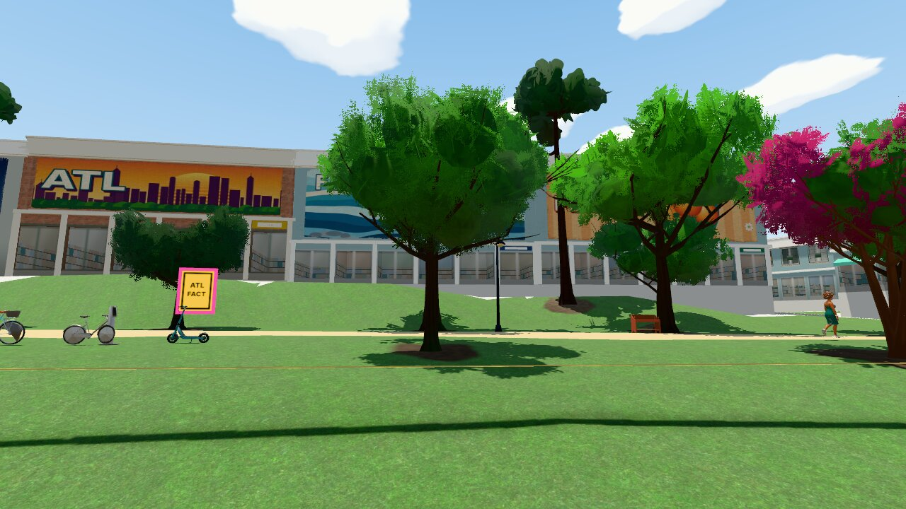
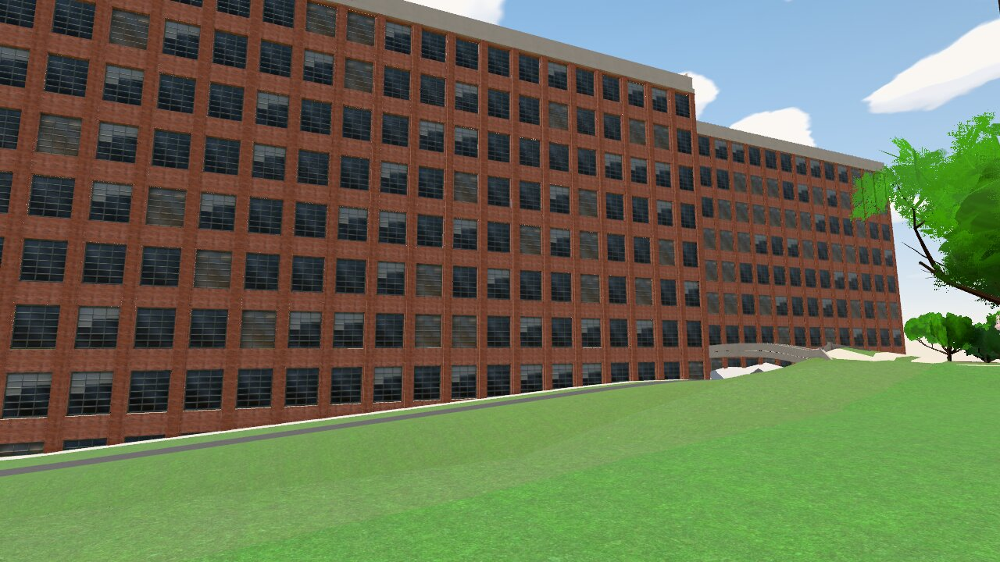
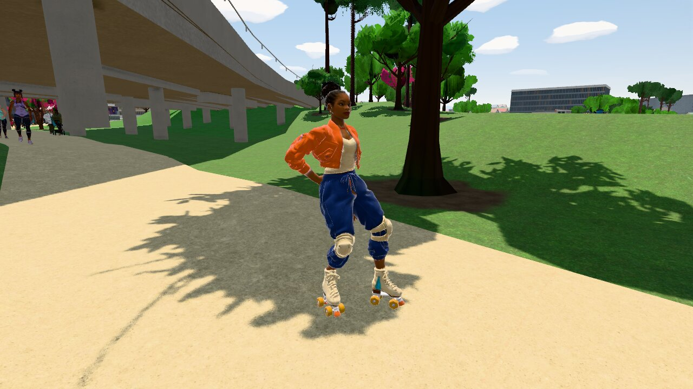

# Style sheet: the pbr look

Issue #157. One page for `?look=pbr`. The rules come from
`docs/art-direction-pbr.md` (#159). The values come from the code:
`src/render/pbr-palette.js` (palette, classes, grade, fog),
`src/render/look.js` (lights, roughness, ground albedo) and the facade
shader in `src/render/geo-view.js`. If the code and this page differ, the
code is correct; change this page.

## Reference screenshots

Real renderer, Playwright headless (Chromium + SwiftShader), 1280×720.
Pinned light: `time=14&weather=clear` (date 06-21). Base URL:
`?level=beltline-eastside&quality=high&look=pbr&date=06-21&time=14&weather=clear&governor=0&view=fixed&mute=1&npcs=0&cars=0&cam=...`.
The cameras are in `scripts/art/shots-style-sheet.json`.
Rebuild: `node scripts/art/pbr-frames.mjs --shots scripts/art/shots-style-sheet.json --out <dir>`,
then `convert -quality 85` to JPEG. The capture data is in
`docs/style-sheet-pbr/provenance.json`.

| Storefronts and murals, 14:00 | Ponce City Market, 14:00 | Skater (Nia) on the BeltLine, 14:00 |
| --- | --- | --- |
|  |  |  |
| Stucco, storefront glass, mural and sign paint, trail concrete, grass | Landmark brick, glass, stone trim | Skin, cloth, trail and bridge concrete, grass |

## Albedo limits

| Limit | Linear | sRGB | Where |
| --- | --- | --- | --- |
| Ceiling | 0.60 | `#cbcbcb` | Every wall, ground and prop. The facade shader scales the whole color down (`albedoCeiling()`), so the hue stays. |
| Trim ceiling | 0.70 | `#dbdbdb` | Thin trim only. Today the shader caps trim at 0.60 too. |
| Floor | 0.03 | `#303030` | Everything except glass and tire rubber. |
| Asphalt | about 0.09 | `#545454` | The darkest ground in a frame. No lilac cast. |
| Grass | `#4f7a3a` to `#6f9a4a` | | Mid green, never mint or gray. Lawn `#628a46`, park `#548d3f` (art color × 0.72 × `GROUND_ALBEDO[3]`). |

## Palette per neighborhood

Hex values are sRGB. All are at or under the ceiling. The grade tint
multiplies the linear color after the tone grade (within 5 % of neutral).
The fog color is the tint the height fog takes (40 % in the day).

| District | Palette | Accent | Grade tint (R, G, B) | Saturation | Fog tint |
| --- | --- | --- | --- | --- | --- |
| Poncey-Highland (Ponce City Market) | `#8c4538` `#9e4d3d` `#c4b08c` `#c9962e` `#4f9aa6` `#c96f6a` `#8fae86` `#cb8f5e` | `#c9962e` mustard, `#2f5d46` deep green | 1.03, 1.00, 0.96 | 1.06 | `#e2cdb4` |
| Old Fourth Ward (Iris O4W) | `#a8a39b` `#525c6b` `#cb7a48` `#6f9bbf` `#383d47` `#b9b2a6` | `#cb6a32` orange, `#6f9bbf` sky blue | 1.00, 1.00, 1.03 | 1.04 | `#c8d6e4` |
| Inman Park (Krog Street Market) | `#8fa88f` `#cbb478` `#a890b8` `#8ab3c7` `#c6c0b0` `#c98fa6` `#b08a68` | `#a890b8` lilac, `#8fa88f` sage | 1.00, 1.02, 0.98 | 1.08 | `#d3dcc2` |
| BeltLine trail and parks (default) | `#b8a27a` `#4f7a3a` `#6f9a4a` `#7a2e2e` `#2e3f66` `#c9962e` | `#7a2e2e` oxblood, `#2e3f66` navy, `#c9962e` mustard | 1.02, 1.00, 0.97 | 1.06 | `#d6e0e8` |
| Landmarks | `#7e3a2e` `#8f4434` `#994a3b` | The fictional rooftop signs | — | — | — |

The district at the camera comes from the anchors in
`src/level/geo/styles.js` (`districtAnchors()`). The look blends over 120 m
past the anchor radius (`districtWeights()`), so there is no cut at a
border. Away from all anchors the trail look applies.

### Style wall colors in the pbr look

The facade shader takes the style color (a linear vertex color), × 0.74,
10 % less chroma, then the ceiling. Effective albedo (sRGB):

| Style | Art colors | pbr albedo | Trim art → pbr |
| --- | --- | --- | --- |
| brick-loft | `#ce9586` `#daa28b` `#c48e81` | `#b18378` `#bb8e7d` `#a87d73` | `#f3efe5` → `#cbc8c0` |
| brick-warehouse | `#c89081` `#d49b89` | `#ac7f73` `#b6897a` | `#ece7dd` → `#cbc7bf` |
| stucco-apartment | `#f9edda` `#fae1ce` `#eff3ec` `#fdf3e2` | `#cbc3b4` `#cbb8ab` `#c8cbc6` `#cbc5b8` | `#fffffd` → `#cbcbca` |
| modern-apartment | `#f3f3f3` `#99a2ad` `#f9ceaa` `#bcd4e5` | `#cbcbcb` `#868d96` `#cbab90` `#a6b9c6` | `#818690` → `#71757d` |
| glass-office | `#adc8da` `#bcceda` | `#99afbd` `#a5b4bd` | `#edf1f3` → `#c7cacb` |
| storefront | `#fde5b3` `#c4e7ed` `#f7cbd4` `#ceeacb` `#fad1aa` | `#cbb995` `#abc6cb` `#cbaab1` `#b6cbb4` `#cbac8f` | `#ffffff` → `#cbcbcb` |
| shotgun-house | `#fdf8ed` `#d4eaf1` `#fdeccb` `#edddef` `#daefda` | `#cbc8c0` `#b5c6cb` `#cbbfa7` `#cabdcb` `#bbcbbb` | `#ffffff` → `#cbcbcb` |
| craftsman-house | `#e1ceb8` `#cedace` `#f1e7d4` `#cbd4e5` | `#c3b5a3` `#b5beb5` `#cbc4b5` `#b3bac7` | `#fdfaf3` → `#cbcac5` |
| industrial-shed | `#dddfe2` `#cbd4da` `#eae5d7` | `#c1c3c5` `#b2b9be` `#cbc7bd` | `#f9d47c` → `#cbaf70` |
| parking-deck | `#e7e7e5` | `#cacac8` | `#fada95` → `#cbb381` |
| church | `#ce998b` `#f3f1ea` | `#b1877c` `#cbcac4` | `#fffdf8` → `#cbcac6` |
| brick-market-hall | `#cb9384` | `#ae8175` | `#adaaa6` → `#979491` |
| garage | `#e5e2dd` `#d4cbc5` | `#c8c6c1` `#b9b2ad` | `#f3f3f3` → `#cbcbcb` |

The brick styles also get the brick scan (scan ÷ its mean), so the mean
stays at the value above.

## Far windows

A window cell under 34 px on screen starts to change to one flat bold
color; under 16 px it is fully flat and the room behind the glass is not
drawn (`FACADE_FADE.bold`). The glass stays smooth, so it still reflects
the sky. The far facade mean uses the same colors (`#474c56`).

| Color | Weight | Use |
| --- | --- | --- |
| `#1c3352` | 0.30 | Deep blue glass |
| `#1f4f55` | 0.22 | Teal glass |
| `#2a2f4f` | 0.18 | Indigo glass |
| `#3f5f80` | 0.12 | Sky reflection |
| `#8a6a3e` | 0.18 | Warm pane (a blind or a lit room) |

The fine detail (scan relief, sill and lintel shadow bands, slab lines,
pane wobble) fades out under 48 to 20 px per window cell
(`FACADE_FADE.fine`), so far buildings do not shimmer.

## Roughness and metalness per material class

`MATERIAL_CLASSES` in `src/render/pbr-palette.js` sets the range of each
class. "In game" is the value the game uses today. For a GLB with a
metal/rough texture, it is the median of the texture × the material factor,
measured in the running game (`?look=pbr&quality=high&skaters=1&time=14&weather=clear`,
5th to 95th percentile of each map, 2026-11-08).

### The eight classes of #157

| Class | Roughness | Metalness | In game |
| --- | --- | --- | --- |
| Brick | 0.80–0.92 | 0 | Facade wall 0.88 with the brick scan roughness map. Landmark GLB brick (`lm_brick_*`) 0.91–0.94, metal 0. |
| Stucco (and painted walls) | 0.75–0.90 | 0 | Facade wall 0.88 with the plaster scan roughness map. |
| Glass | 0.03–0.28 | 0 | Facade panes 0.03–0.28 (`facadeGlassRough`), base 0.08. Landmark windows (`lm_window`) median 0.22, metal 0. |
| Asphalt | 0.85–0.95 dry, 0.12–0.30 wet | 0 | Ground scan roughness map, floor 0.75, × 0.3 when wet. |
| Concrete (sidewalk, trail, ledges, bridges) | 0.75–0.95 (bridges 0.75–0.92, `CONCRETE`) | 0 | Ground scan, floor 0.75. Geo bridges 0.75–0.92. Landmark concrete (`lm_concrete`) 0.61–0.64: under the class, see "Open". |
| Skin | 0.45–0.60 | 0 | Player and NPC skaters: GLB map with a floor of 0.42 (`characterRoughness()`). Procedural walkers 0.55 on the skin part (`PED_ROUGHNESS.skin`, this change). Meshy walkers one map for skin and clothes, median 0.43–0.69, metal 0.04 or less. |
| Cloth | 0.70–0.95 | 0 | Skater GLB maps median 0.40–0.92 over the 0.42 floor. Procedural walkers 0.82 (`PED_ROUGHNESS.cloth`, this change). Capsule crowd 0.8. |
| Paint (signs, awnings, sign blades, murals, car paint) | Sign and awning paint 0.6–0.9. Mural paint 0.70–0.85. Car paint 0.2–0.4. | 0 | Props 0.8, shop names 0.8, street sign blades 0.55, mural 0.85 with a roughness atlas, procedural cars 0.32, Meshy car GLBs median 0.28–0.29. |

### Other classes

| Class | Roughness | Metalness | In game |
| --- | --- | --- | --- |
| Grass, mulch, soil | 0.92–1.0 | 0 | Ground scan, floor 0.92. |
| Painted and bare metal (rails, poles) | 0.25–0.6 | 0.6–1.0 | Landmark sign frames and letters 0.25–0.88, metal 0 to 1. The edge fence posts are painted at metal 0 (0.45). Meshy props: the metal parts (fountain, bike dock, sculpture) read 0.7–0.97 metal; the plastic and wood parts read 0. |

Metal is only for real metal. Every lit object in the pbr look uses
`MeshStandardMaterial` (or `MeshPhysicalMaterial` from a GLB). Unlit
`MeshBasicMaterial` stays only for emissive or baked parts: the car lamps
and beams, the fact cards, the tree impostors, the landmark shadow proxies
and the skater shadow blobs. `window.__atl.materials` (`materialAudit()`)
lists the material types, the toon materials, the ink hulls, the toon
ramps, the Lambert and Phong materials, and the unlit materials by path.
`e2e/pbr-materials.spec.js` fails on any of them, or on an unlit material
that is not on its list.

### People palette

The procedural walkers (`src/render/ped-look.js`). The colors are sRGB
albedo; the pbr look keeps them as they are.

| Part | Colors |
| --- | --- |
| Skin (12 tones) | `#3b2219` `#4a2c1d` `#5a3825` `#6e4430` `#7a4b2a` `#8d5a3b` `#9c6b43` `#b07a52` `#c68e5e` `#d8a679` `#e0b48a` `#f1cfa8` |
| Shirts | `#e03a3e` `#ffd23f` `#2ec4b6` `#ff8c42` `#9b5de5` `#8ac926` `#3a86ff` `#f15bb5` `#00bbf9` `#ffffff` `#c8102e` `#1d428a` `#f4a7b9` `#b8e0d2` `#fff1a8` `#2b2d42` `#9a9a9a` `#7a3e9d` `#e76f51` `#40916c` |
| Pants | `#2b2d42` `#3d405b` `#4a6fa5` `#6b8cbf` `#1d2b4f` `#6b705c` `#e9d8a6` `#22223b` `#8d6346` `#5c5c5c` `#f2efe6` `#556b2f` `#7f1d1d` |
| Hair | `#111111` `#1b1b1b` `#2e1f14` `#3b2a1a` `#4b3621` `#6d4c33` `#8a8a8a` `#c9c9c9` `#8c3b1e` `#c8a165` `#d63c8a` `#2aa198` |
| Accents (bags, hats, jackets) | `#264653` `#e9c46a` `#f4a261` `#2a9d8f` `#e63946` `#1d3557` `#6d597a` `#8d6346` `#111111` `#f1faee` `#588157` `#ff006e` |

Some shirts (`#ffffff`, `#fff1a8`, `#ffd23f`) are over the 0.6 albedo
ceiling. They are small on screen, so the ceiling is not applied to them
today.

### Open

- Landmark concrete (`lm_concrete`, `lm_roof`, `lm_trim`) reads 0.61–0.64,
  under the concrete class (0.75). Bake the GLB maps again or raise the
  factor.
- The NPC skater model of the berry, lime and sunset outfits has metal
  noise in its map (95th percentile up to 0.21). Cloth must be metal 0.
  Clean the map (Blender-MCP) or cap the metalness of non-metal parts.
- Meshy walkers have one map for skin and clothes. Their clothes (median
  about 0.6) are under the cloth class.

## Light and grade

| Item | Value | Where |
| --- | --- | --- |
| Tone mapping | Neutral, exposure 1.0 (the weather eases it at night) | `LOOKS.pbr`, `weather-view.js` |
| Sun | Weather sun (real solar position, 3.0 peak) × 1.4 = 4.2 peak | `LOOKS.pbr.sunScale`, `pbr-look.js` |
| Sky environment | Baked again from the sky dome when its colors move (dusk, night, clouds). Intensity 0.6 × `1 / sqrt(sky luma / 0.55)`, cap × 3; ground bounce × the same luma ratio, floor 0.15 | `envForSky()`, `pbr-look.js` |
| Contrast (luma, pivot 0.18) | day 1.14, golden 1.12, dusk 1.00, night 1.04 | `TIME_GRADES` |
| Saturation | day 1.06, golden 1.14, dusk 1.04, night 1.12 (× district) | `TIME_GRADES` |
| Split tone (cool shadows, warm lights) | day 0.35, golden 1.0, dusk −0.35 (cool), night 0.45; clouds cut it by up to 70 % | `TIME_GRADES`, `SPLIT` |
| Black lift | dusk 0.010, night 0.006 (linear) | `TIME_GRADES` |
| Bloom threshold | 2.4 in the day, 0.92 at night (no sunlit surface glows) | `bloomThreshold()` |
| Height fog | the distance fog, × 0.55 high up, full under the eye; ground haze up to 0.16; full at the far plane at every height | `HEIGHT_FOG` |
| Skater rim | horizon color mixed with warm white; strength 0.55 day, 0.8 golden, 0.45 dusk, 0.3 night; power 3 | `SKATER_RIM`, `toon.js` |
| Ambient occlusion | GTAO as on `epic/city-look` (not changed here; PR #166 tunes it) | `src/render/post.js` |

## Political rules (AGENTS.md)

Every neighborhood at its best. Murals, not graffiti. No crime or police
content. The palette and the grade make the city warm and clean; they
never make a neighborhood look run down.
